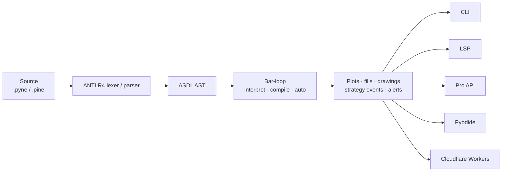

<!--
  Copyright (c) 2024–2026 HOOX · jango-blockchained (hoox-sh)
  SPDX-License-Identifier: AGPL-3.0-or-later
-->

# PYNE

An independent open toolchain for the Pine Script™ language: ANTLR4 grammar, ASDL AST, dual-engine bar-loop runtime, language server, and HTTP evaluate surface.

Pine is usually executed inside a host chart. PYNE models the language as an inspectable pipeline — source through parse, AST, and deterministic bar-loop evaluation — so the same scripts can be analysed and run outside any particular UI. Import `pynescript`. CLIs: `pyne`, `pyne-lsp`, `pyne-mcp` (aliases `pynescript`, `pynescript-lsp`).

**0.6.28** · PyPI [`hoox-pyne`](https://pypi.org/project/hoox-pyne/)

<div align="center">


[](https://github.com/hoox-sh/hoox)
[](https://github.com/hoox-sh/pyne)
[](https://github.com/hoox-sh/axis)
[](https://github.com/hoox-sh/pyne/actions/workflows/ci.yml)
[](https://codecov.io/gh/hoox-sh/pyne)
[](https://www.python.org/)
[](https://pypi.org/project/hoox-pyne/)
[](LICENSE)

[hoox.sh](https://hoox.sh) · [hoox.sh/pyne](https://hoox.sh/pyne) · [docs](https://hoox.sh/pyne/docs) · [CHANGELOG](CHANGELOG.md)

</div>

PYNE is the **language engine**. [HOOX](https://github.com/hoox-sh/hoox) is the execution mesh; [AXIS](https://github.com/hoox-sh/axis) is the charting PWA. All three publish under [hoox.sh](https://hoox.sh).

---

## Pipeline



The same contract underlies the desk CLI, `pyne-lsp`, Flask `POST /run`, AXIS in-browser Pyodide, and [pyne-worker](https://github.com/hoox-sh/pyne-worker) (`POST /run` at the edge). Coverage and gaps: [compatibility](https://hoox.sh/pyne/docs/reference/compatibility) · [missing features](https://hoox.sh/pyne/docs/reference/missing-features). This tree does not ship third-party script corpora or TradingView® builtin downloads.

## Features

| Area | What you get |
| --- | --- |
| **Parser** | ANTLR4 v5/v6 grammar, ASDL AST, parse ↔ unparse, structural linter |
| **Runtime** | Deterministic bar-loop interpret + Numba compile (`auto`), sessions, strategies, alerts, drawings |
| **Language server** | Diagnostics, completion (~800+ builtins), hover, navigation, semantic tokens, formatting, Convert to v6 |
| **CLI** | `check`, `format`, `lint`, `compile`, `run`, `execute`, `data`, `prewarm`, `mcp` |
| **MCP** | Stdio server + `pyne mcp call` for parse / lint / convert / compile / run |
| **Backends** | Flask Pro API (`/run`, batch, preview, backtest, optimize), Cloudflare Workers, Pyodide |
| **Editors** | VS Code (Void / Volt / Orange themes), Neovim, Zed, Emacs |

---

## Surfaces

| Surface | Role |
| --- | --- |
| **CLI** (`pyne`) | Check, format, lint, compile, `run` (compile smoke), `execute` (`Runtime.run`), data, prewarm, MCP `call` |
| **LSP** (`pyne-lsp`) | Diagnostics, completion (~800+ builtins), hover, navigation, semantic tokens, formatting |
| **MCP** (`pyne-mcp` / `pyne mcp`) | Stdio server and in-process `pyne mcp call` — parse / lint / convert / compile / `Runtime.run` |
| **VS Code** | First-class `.pyne` / `.pine` ([extension](./vscode-extension/)) |
| **Pro API** | HTTP evaluate, batch, chart preview, quick backtest, `/optimize`, datafeed |
| **Editors** | Neovim, Zed, Emacs under [`clients/`](./clients/) |
| **PyneTS** | TypeScript / Bun library [`@hoox-sh/pynets`](https://github.com/hoox-sh/pynets) |

**Front-end.** Approximate Pine v5–v6 via ANTLR4 resource grammars; ASDL AST with visitor/transformer; parse → unparse; structural linter.

**Runtime.** Deterministic indicator and strategy evaluation on OHLCV. Dual engine: interpret (AST walk) and compile (Numba nopython with object-mode fallback); `mode` ∈ {`auto`, `compile`, `interpret`}. Persistent sessions (`Runtime.create_session`, `append_bars`, `update_last_bar`). Alerts with documented frequency. Strategy entries/exits, commission/slippage, drawing GC. `request.security` same-symbol simple OHLCV and allowlisted `ta.*`; foreign or complex security resolves to `na`.

---

## Install

```bash
pip install hoox-pyne                 # library + CLI
pip install "hoox-pyne[lsp]"          # language server
pip install "hoox-pyne[compile]"      # Numba path
pip install "hoox-pyne[data]"         # market data
pip install "hoox-pyne[pro]"          # Flask Pro API
pip install "hoox-pyne[mcp]"          # stdio MCP (pyne mcp call needs no extra)

git clone https://github.com/hoox-sh/pyne.git
cd pyne
pip install -e ".[lsp,pro]"
```

GHCR multi-arch images on `v*` tags:

```bash
docker pull ghcr.io/hoox-sh/pyne/cli:0.6.28
docker run --rm -v "$PWD:/work" -w /work ghcr.io/hoox-sh/pyne/cli:0.6.28 check script.pine

docker pull ghcr.io/hoox-sh/pyne/lsp:0.6.28
docker run --rm -i -v "$PWD:/work" -w /work ghcr.io/hoox-sh/pyne/lsp:0.6.28

docker pull ghcr.io/hoox-sh/pyne/api:0.6.28
docker run --rm -p 5002:8080 -e ADMIN_TOKEN=… ghcr.io/hoox-sh/pyne/api:0.6.28
```

Packages: [ghcr.io/hoox-sh/pyne](https://github.com/hoox-sh/pyne/pkgs/container/pyne%2Fcli).

Edge `POST /run` (thin Workers host, separate repo):

[](https://deploy.workers.cloudflare.com/?url=https://github.com/hoox-sh/pyne-worker)

Read [pyne-worker limitations](https://github.com/hoox-sh/pyne-worker#limitations-read-before-you-click-deploy) before deploying.

---

## Quickstart

```python
from pynescript.ast.helper import parse, unparse, literal_eval

source = """
//@version=6
indicator("My RSI")
plot(ta.rsi(close, 14))
"""
print(unparse(parse(source)))
literal_eval("1 + 2 * 3")  # 7
```

```bash
pyne check script.pine
pyne format script.pine -w
pyne lint script.pine
pyne execute script.pine --mode interpret --bars 50
pyne compile script.pine --emit
pyne data AAPL --provider yahoo --period 6mo
pyne mcp tools
pyne mcp call lint script.pine
```

```bash
pip install "hoox-pyne[lsp]"
pyne-lsp
```

```bash
pip install "hoox-pyne[mcp]"
pyne mcp config          # mcpServers JSON
pyne mcp                 # stdio
pyne mcp call execute script.pine --arg bars=50 --arg mode=interpret
```

MCP catalog: [tools](https://hoox.sh/pyne/docs/enduser/reference/mcp-tools). Editors: [VS Code](./vscode-extension/); Neovim / Zed / Emacs in [`clients/`](./clients/). CLI map: [commands](https://hoox.sh/pyne/docs/enduser/reference/cli-commands).

### Pro API

`make run` binds `:5002`. `POST /run` accepts `mode` ∈ {`auto`, `compile`, `interpret`} and returns plots, series, events, drawings, alerts (`error_kind` / `error_bar` on failure). Optional `webhook_url` / `ALERT_WEBHOOK_URL` for last-bar alert firings.

```bash
make run

curl -s http://127.0.0.1:5002/run \
  -H 'Content-Type: application/json' \
  -d '{
    "script": "//@version=6\nindicator(\"demo\")\nplot(close)",
    "data": [{"open":1,"high":2,"low":0.5,"close":1.5,"time":1,"volume":1}],
    "mode": "auto"
  }'
```

Also: `/run/batch`, `/compile/prewarm`, `/preview/chart`, `/backtest/quick`, `/optimize`, `/lsp/*`, CCXT datafeed, optional hosted runner (`PYNE_RUNNER=1`). Docs: [POST /run](https://hoox.sh/pyne/docs/api/endpoints/run) · [API](https://hoox.sh/pyne/docs/api).

---

## MCP

PYNE ships a [Model Context Protocol](https://modelcontextprotocol.io) server so agents and editors can parse, lint, convert, compile, and run Pine without shelling out.

```bash
pip install "hoox-pyne[mcp]"
pyne mcp tools                  # list every tool
pyne mcp config                 # print the mcpServers JSON
pyne mcp                        # stdio server (pyne-mcp)
pyne mcp call lint script.pine  # in-process call, no server
```

| Tool | Purpose |
| --- | --- |
| `pyne_parse` / `pyne_check` | Parse source → AST / diagnostics |
| `pyne_lint` / `pyne_format` | Structural lint and format |
| `pyne_convert` | Convert Pine v1–v5 toward v6 |
| `pyne_compile` / `pyne_prewarm` | Compile to the Numba IR / warm caches |
| `pyne_run` / `pyne_execute` | `Runtime.run` over OHLCV (`interpret` / `compile` / `auto`) |
| `pyne_hover` / `pyne_complete` / `pyne_signature` | Language intelligence for editors |
| `pyne_optimize` | Strategy HPO |
| `pyne_runner_*` | Hosted script registry + bar-close ticks |

Client config (`pyne mcp config` prints this):

```json
{
  "mcpServers": {
    "pyne": { "command": "pyne-mcp" }
  }
}
```

Full catalog: [MCP tools](https://hoox.sh/pyne/docs/enduser/reference/mcp-tools) · [MCP guide](https://hoox.sh/pyne/docs/enduser/guides/mcp).

---

## Compatibility

PYNE targets practical runtime fidelity against first-party fixtures, unit tests, and (when present locally) open-source corpus sets. It does not claim TradingView® certification, complete platform parity (chart host, data model, every builtin, closed UI), or bar-for-bar agreement with the TradingView® platform.

Results are for research, development, and self-hosted evaluation. They are not financial advice and are not provided by TradingView, Inc.

---

## Documentation

Canonical docs: **[hoox.sh/pyne/docs](https://hoox.sh/pyne/docs)**

| Topic | Link |
| --- | --- |
| Install · quick start | [Getting started](https://hoox.sh/pyne/docs/enduser/getting-started/installation) |
| CLI | [Guide](https://hoox.sh/pyne/docs/enduser/guides/cli) · [commands](https://hoox.sh/pyne/docs/enduser/reference/cli-commands) |
| MCP | [Guide](https://hoox.sh/pyne/docs/enduser/guides/mcp) · [tools](https://hoox.sh/pyne/docs/enduser/reference/mcp-tools) |
| Runtime | [Evaluate](https://hoox.sh/pyne/docs/enduser/guides/evaluate-scripts) · [alerts](https://hoox.sh/pyne/docs/runtime/alerts) · [compiler](https://hoox.sh/pyne/docs/runtime/compiler/overview) |
| Pro API | [API](https://hoox.sh/pyne/docs/api) |
| LSP | [Hub](https://hoox.sh/pyne/docs/lsp) · [VS Code](https://hoox.sh/pyne/docs/lsp/vscode-extension) |
| Coverage | [Compatibility](https://hoox.sh/pyne/docs/reference/compatibility) · [missing](https://hoox.sh/pyne/docs/reference/missing-features) |
| In-tree | [CHANGELOG](./CHANGELOG.md) · [CONTRIBUTING](./CONTRIBUTING.md) · [SECURITY](./SECURITY.md) |

```bash
make install   # editable + LSP
make test      # pytest
make lint      # ruff
```

---

## Ecosystem

```
                    https://hoox.sh
           ┌──────────────┼──────────────┐
           ▼              ▼              ▼
         HOOX            PYNE           AXIS
    (edge execution)  (Pine engine)  (charting UI)
```

| Product  | Role                                                         | Docs                                           |
| -------- | ------------------------------------------------------------ | ---------------------------------------------- |
| **HOOX** | Signal in → risk → CEX / DEX hop → notify                    | [docs.hoox.sh](https://docs.hoox.sh)           |
| **PYNE** | Pine Script™ grammar, AST, dual-engine runtime, LSP, Pro API | [hoox.sh/pyne/docs](https://hoox.sh/pyne/docs) |
| **AXIS** | Installable charting PWA (Solid + Vite; offline via Pyodide) | [hoox.sh/axis/docs](https://hoox.sh/axis/docs) |

Satellites: [PyneTS](https://github.com/hoox-sh/pynets), [pyne-worker](https://github.com/hoox-sh/pyne-worker), [pyne-agent-worker](https://github.com/hoox-sh/pyne-agent-worker), [pyne-lsp / pyne-vscode](https://github.com/hoox-sh/pyne) (in this tree), [axis-plugin-boilerplate](https://github.com/hoox-sh/axis-plugin-boilerplate). HOOX isolate list: [hoox-sh/hoox](https://github.com/hoox-sh/hoox#architecture).

---

## License

**SPDX:** `AGPL-3.0-or-later` · Copyright (C) 2024–2026 jango_blockchained · [LICENSE](./LICENSE).

Educational and research use. Trading involves substantial risk of loss. This is not financial advice.

_Pine Script™_ and _TradingView®_ are trademarks of [TradingView, Inc.](https://www.tradingview.com/); _Cloudflare®_ is a trademark of Cloudflare, Inc. PYNE is an independent, unofficial implementation. It is not affiliated with, authorized by, sponsored by, or endorsed by TradingView, Inc. or Cloudflare, Inc.
