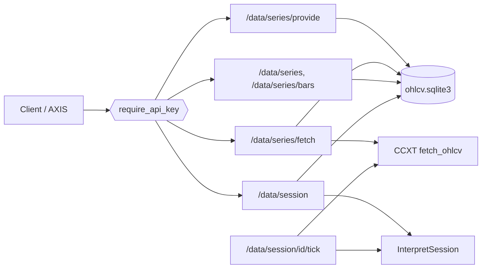

# Copyright (C) 2024-2026 jango_blockchained
#
# This file is part of pynescript.
#
# pynescript is free software: you can redistribute it and/or modify
# it under the terms of the GNU Affero General Public License as published by
# the Free Software Foundation, either version 3 of the License, or
# (at your option) any later version.
#
# pynescript is distributed in the hope that it will be useful,
# but WITHOUT ANY WARRANTY; without even the implied warranty of
# MERCHANTABILITY or FITNESS FOR A PARTICULAR PURPOSE.  See the
# GNU Affero General Public License for more details.
#
# You should have received a copy of the GNU Affero General Public License
# along with pynescript.  If not, see <https://www.gnu.org/licenses/>.
#
# SPDX-License-Identifier: AGPL-3.0-or-later

---
title: "Data plane"
description: "Engine-owned OHLCV series store and data-bound live sessions — /data/series* and /data/session*."
---

# Data plane

## Abstract

`POST /run` takes its bars **in the request**. That is fine for a one-shot evaluate, but a live chart re-sends the entire history on every tick and asks the exchange for bars the server already has.

The **data plane** moves bars out of the request body and into an engine-owned store:

- **`/data/series*`** — a SQLite-backed OHLCV store keyed by a canonical series key. Upload closed bars, fetch history from CCXT, read bounds, read the newest window.
- **`/data/session*`** — a live session **bound to a stored series**, advanced from the engine feed instead of the client payload.

Bars are keyed by `exchange|market|SYMBOL|interval` — for example `binance|spot|BTC/USDT|1h`. Upserts are keyed by unix-second `time` and the **later write wins**, so a forming bar is re-written in place rather than duplicated.

Implemented in `backend/datastore/series.py` and `backend/api/data_series.py`, without Flask or CCXT in the store itself.

## Conceptual model



## Series key

Every route takes the same four fields. `market` is optional and defaults to `spot`.

| Field | Rule | Example |
| --- | --- | --- |
| `exchange` | CCXT id, letters/digits/`-`/`_`, lowercased | `binance` |
| `market` | one of the supported markets, default `spot` | `spot` |
| `symbol` | a pair, uppercased | `BTC/USDT` |
| `interval` | canonicalized | `1h` |

Responses echo the normalized key text, e.g. `binance|spot|BTC/USDT|1h`.

## Interface surface

<Note>
All `/data/*` routes require an **API key** (`Authorization: Bearer …`, `X-API-Key`, or `?api_key=`). They move and persist user market data, so they are not on the free path. Unauthenticated calls return `401 UNAUTHORIZED`.
</Note>

### `GET /data/series`

Stored bounds for one series. Unknown series report count `0` rather than `404`.

```json
{ "status": "success", "key": "binance|spot|BTC/USDT|1h",
  "count": 30, "oldest": 1700000000, "newest": 1700104400, "updated_at": 1791968289 }
```

### `GET /data/series/bars`

Newest stored bars, **ascending**. `limit` defaults to the store window default and is capped at the store maximum.

```json
{ "status": "success", "key": "binance|spot|BTC/USDT|1h", "count": 2,
  "bars": [ { "time": 1700100800, "open": 128.0, "high": 129.0,
              "low": 127.0, "close": 128.5, "volume": 10.0 }, … ] }
```

### `POST /data/series/provide`

Upload closed bars. At most **5,000** per request; over that is `413 BATCH_TOO_LARGE` — split the upload into chunks.

```json
{ "status": "success", "key": "binance|spot|BTC/USDT|1h",
  "added": 30, "updated": 0, "count": 30, "newest": 1700104400 }
```

### `POST /data/series/fetch`

Walk CCXT `fetch_ohlcv` pages forward from `now - history_bars` and persist. `history_bars` defaults to 5,000 and caps at 100,000. Upstream failure is `502 UPSTREAM`; missing `ccxt` is `503 CCXT_UNAVAILABLE`.

```json
{ "status": "success", "key": "binance|spot|BTC/USDT|1h",
  "fetched": 5000, "count": 5000, "oldest": …, "newest": … }
```

### `POST /data/session`

Build a live interpret session over the stored window and bind it to the series key. Accepts the same script/inputs/realtime fields as [live sessions](/pyne/docs/api/endpoints/sessions) plus `exchange`, `symbol`, `interval`, `market`, and `history_bars`.

Returns the `/session` envelope plus `session_id`, `cache`, and `data`:

```json
{ "status": "success", "session_id": "49564cd995514ef48254eb9dd5322e90",
  "count": 20, "cache": "hit",
  "data": { "key": "binance|spot|BTC/USDT|1h", "count": 30, "newest": 1700104400 } }
```

When the store holds fewer than `history_bars` bars it returns `409 DATA_MISS` with `have` and `need` rather than silently evaluating a short history:

```json
{ "status": "miss", "code": "DATA_MISS", "have": 0, "need": 50 }
```

### `POST /data/session/<session_id>/tick`

Takes `{ exchange, symbol }` only — the series binding is already established. It fetches candles from **two bars before** the stored newest (so a corrected or still-forming bar is picked up), persists closed bars, re-ticks the forming bar with `update_last_bar`, and appends newer bars with `append_bars`.

The response adds `appended`, `forming`, and `unchanged`:

```json
{ "status": "success", "session_id": "…", "count": 31,
  "appended": 1, "forming": true, "unchanged": false }
```

`409 SESSION_KEY_MISMATCH` guards a session bound to another series. Upstream failure is `502 UPSTREAM` and **keeps** the session.

## Storage

| Property | Value |
| --- | --- |
| Backend | SQLite (`ohlcv.sqlite3`), single connection |
| Directory | `PYNE_DATA_DIR`, default `data/` |
| Identity | `exchange\|market\|SYMBOL\|interval` |
| Upsert key | unix-second `time`; later write wins |

The store writes through a single connection, so the data plane has the same **single-worker** constraint as live sessions (`GUNICORN_WORKERS=1`). Serving it from more than one worker without a shared volume will silently split history.

## Failure modes

| Symptom | Code / status | Cause | Fix |
| --- | --- | --- | --- |
| `401` | `UNAUTHORIZED` | No API key | Send `Authorization: Bearer` |
| `400` | `INVALID_KEY` | Missing/malformed `exchange` / `symbol` | Use a CCXT id and a pair |
| `400` | `INVALID_MARKET` | Unsupported market | Use `spot` (default) |
| `413` | `BATCH_TOO_LARGE` | >5,000 bars in one upload | Chunk the upload |
| `409` | `DATA_MISS` | Store shorter than `history_bars` | `/data/series/fetch` or `provide` first |
| `409` | `SESSION_KEY_MISMATCH` | Wrong series for this session | Release and rebind |
| `502` | `UPSTREAM` | CCXT fetch failed | Check creds / connectivity; session kept |
| `503` | `CCXT_UNAVAILABLE` | `ccxt` not installed | `pip install 'pyne[datafeed]'` |

## Internals (map)

| Path | Role |
| --- | --- |
| `backend/datastore/series.py` | SQLite OHLCV store, `SeriesKey`, upsert/window/status |
| `backend/datastore/live.py` | Session ↔ series binding + `sync_session` |
| `backend/api/data_series.py` | `/data/series*` routes, CCXT page walk |
| `backend/app.py` | `/data/session`, `/data/session/<id>/tick` |
| `backend/api/datafeed.py` | Shared CCXT provider + candle mapping |

## See also

- [Live sessions](/pyne/docs/api/endpoints/sessions)
- [Auth and keys](/pyne/docs/api/auth-and-keys)
- [Observability](/pyne/docs/devops/observability)