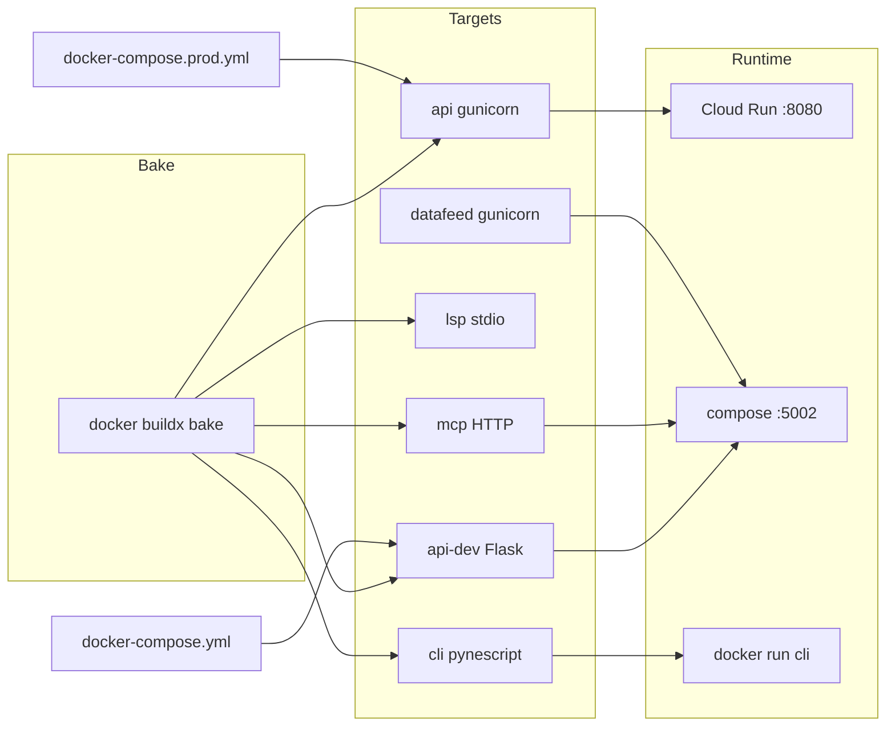

# Copyright (C) 2024-2026 jango_blockchained
#
# This file is part of pynescript.
#
# pynescript is free software: you can redistribute it and/or modify
# it under the terms of the GNU Affero General Public License as published by
# the Free Software Foundation, either version 3 of the License, or
# (at your option) any later version.
#
# pynescript is distributed in the hope that it will be useful,
# but WITHOUT ANY WARRANTY; without even the implied warranty of
# MERCHANTABILITY or FITNESS FOR A PARTICULAR PURPOSE.  See the
# GNU Affero General Public License for more details.
#
# You should have received a copy of the GNU Affero General Public License
# along with pynescript.  If not, see <https://www.gnu.org/licenses/>.
#
# SPDX-License-Identifier: AGPL-3.0-or-later

---
title: "Docker"
description: "Buildx multi-target images and Compose profiles for the PYNE Pro API, datafeed, MCP, CLI, and LSP."
---

# Docker

## Abstract

Containers package the **Pro API** (Flask + evaluator), the **CCXT datafeed**, **PYNE MCP**, the **CLI** (`pynescript`), and the **LSP** for reproducible local runs and Cloud Run deploys. A single multi-stage `Dockerfile` exposes named targets; **Docker Buildx Bake** (`docker-bake.hcl`) drives local loads and multi-platform release builds. Compose wires volume mounts and optional Redis/LSP/CLI profiles for desk development, with a production overlay for gunicorn.
## Conceptual model



## Interface surface

### Dockerfile targets

| Target | Process model | Audience |
| --- | --- | --- |
| `api` | `entrypoint-api.sh` → gunicorn (`0.0.0.0:$PORT`) | Production / Cloud Run / compose prod |
| `api-dev` | `python -m backend.app` with `HOST=0.0.0.0` | Local compose (source mounts) |
| `lsp` | `ENTRYPOINT pyne-lsp` (stdio) | Compose profile `lsp`; GHCR `ghcr.io/hoox-sh/pyne/lsp` |
| `mcp` | `ENTRYPOINT pyne-mcp` (`streamable-http` on `:8080`) | Compose daemon `mcp`; GHCR `ghcr.io/hoox-sh/pyne/mcp` |
| `cli` | `entrypoint-cli.sh` → `pyne` (fallback `pynescript`; ephemeral; `/work` CWD) | CI gates, one-shot parse/lint/compile/run |

Datafeed reuses the `api` / `api-dev` image with `GUNICORN_APP=backend.datafeed_app:app` (prod) or `python -m backend.datafeed_app` (dev). RAM sessions live in that process — do not split `/datafeed/session` and `/datafeed/watch`.

All targets: Python 3.12-slim, non-root `appuser` (uid 1000). API targets also set `API_KEY_STORE=/data/api_keys.json`, `MPLBACKEND=Agg`, healthcheck via `curl`. The **cli** image installs `.[compile,data]` only (no Flask/matplotlib) and is smaller/faster to build than `api`.
### Buildx Bake (`docker-bake.hcl`)

```bash
# Local load (host platform)
docker buildx bake api                 # production image → pynescript-api:latest
docker buildx bake cli                 # CLI image → pynescript-cli:latest (ENTRYPOINT: pyne)
docker buildx bake lsp                 # LSP image → pynescript-lsp:latest (ENTRYPOINT: pyne-lsp)
docker buildx bake mcp                 # MCP image → pynescript-mcp:latest (ENTRYPOINT: pyne-mcp)
docker buildx bake                     # default group: api + api-dev
docker buildx bake all                 # api + api-dev + lsp + cli + mcp

# Multi-platform (amd64 + arm64). Set REGISTRY to push:
REGISTRY=ghcr.io/hoox-sh/pyne TAG=0.6.31 docker buildx bake release
# release group = api-release + cli-release + lsp-release + mcp-release
# → ghcr.io/hoox-sh/pyne/{api,cli,lsp,mcp}:0.6.31  (or :latest)
# Prefer: make docker-push-ghcr  (workflow GHCR on v* tags)
```

Make wrappers:

```bash
make docker-build       # bake api
make docker-build-cli   # bake cli
make docker-build-lsp   # bake lsp
make docker-build-mcp   # bake mcp
make docker-build-all   # bake all targets
make docker-buildx      # bake release (multi-platform)
make docker-push-ghcr   # gh workflow run ghcr.yml
make docker-cli ARGS="check script.pine"   # compose profile cli
```

One-time multi-platform builder (if needed):

```bash
docker buildx create --use --name pynescript
```

### Compose

```bash
cp .env.example .env   # optional overrides

make docker-up         # api-dev on host :5002 (API only)
make docker-up-full    # daemons: api + redis + datafeed + mcp
make docker-prod       # requires ADMIN_TOKEN; gunicorn; all services
make docker-smoke      # curl http://127.0.0.1:5002/
make docker-down

# stdio LSP (interactive)
docker compose --profile lsp run --rm lsp

# CLI (ephemeral; mounts repo at /work)
docker compose --profile cli run --rm cli check script.pine
# ≡ make docker-cli ARGS="check script.pine"
```

| Service | Profile | Notes |
| --- | --- | --- |
| `api` | default | Port `${API_PORT:-5002}:8080`, ro mounts of `src/` + `backend/`, volume `api_data` → `/data` |
| `redis` | default | redis:7-alpine, AOF, **no published ports** (internal network only) |
| `datafeed` | default | Host `127.0.0.1:${DATAFEED_PORT:-5004}`; same API image; `GET /datafeed/health` |
| `mcp` | default | Host `127.0.0.1:${MCP_PORT:-5003}`; `PYNE_MCP_TRANSPORT=streamable-http`; `GET /mcp` |
| `lsp` | `lsp` | stdio; `docker compose run --rm lsp` for interactive; prod `up` also starts it |
| `cli` | `cli` | `entrypoint-cli.sh` → `pyne`; mounts `.:/work` + `src` + `cli_data` |

Network name: `pynescript-dev`.

Production overlay (`docker-compose.prod.yml`): target `api`, **`volumes: !override`** so only `api_data:/data` remains (dev source binds are dropped), SQLite key store on `/data`, mem/cpu caps, requires `ADMIN_TOKEN`. **`up --build -d` with no service names** (and profiles `lsp` + `cli`) starts the full project — passing `api` leaves the rest down.

### Environment variables

| Variable | Default | Meaning |
| --- | --- | --- |
| `PORT` | `8080` | Listen port inside the container |
| `HOST` | `0.0.0.0` | Bind address (dev Flask runner) |
| `API_PORT` | `5002` | Host port published to container `8080` |
| `DATAFEED_PORT` | `5004` | Host port for the datafeed daemon (`127.0.0.1`) |
| `MCP_PORT` | `5003` | Host port for MCP streamable-http (`127.0.0.1`) |
| `PYNE_MCP_TRANSPORT` | `stdio` (CLI) / `streamable-http` (compose) | MCP listen mode |
| `PYNE_MCP_HOST` / `PYNE_MCP_PORT` | `127.0.0.1` / `8000` | HTTP bind inside the MCP process (compose: `0.0.0.0` / `8080`) |
| `GUNICORN_APP` | `backend.app:app` | WSGI target; datafeed sets `backend.datafeed_app:app` |
| `FLASK_ENV` | `production` / `development` | App mode by target |
| `STORE_BACKEND` | `json` (prod overlay: `sqlite`) | `json` \| `sqlite` \| `redis` |
| `API_KEY_STORE` | `/data/api_keys.json` | JSON key store path (`STORE_BACKEND=json`) |
| `API_KEY_STORE_SQLITE` | `/data/api_keys.db` | SQLite path (`STORE_BACKEND=sqlite`) |
| `ALLOWED_ORIGINS` | compose default includes `https://hoox.sh`, `https://hoox.sh/axis`, and **local AXIS `:8081`** | CORS allow-list |
| `ADMIN_TOKEN` | unset | Required for `POST /auth/create_key` (`X-Admin-Token`) and prod compose |
| `PYNE_RUNNER` | `0` | Optional hosted runner ([docs](/pyne/docs/api/endpoints/runner)). `1` enables `/scripts` + `/cron/*` |
| `PYNE_RUNNER_SCHEDULER` | `0` | In-process bar-close poll. Prefer `GUNICORN_WORKERS=1` when on |
| `PYNE_RUNNER_DB` | `/data/runner.db` | SQLite on the `api_data` volume |
| `REDIS_URL` | empty in prod; compose dev default `redis://redis:6379/0` | Required when `STORE_BACKEND=redis` |
| `GUNICORN_WORKERS` / `GUNICORN_THREADS` / `GUNICORN_TIMEOUT` | `1` / `100` / **`120`** (entrypoint + prod compose; worker class hard-pinned `gthread`) | Prod entrypoint knobs |
| `GUNICORN_BIND` | `0.0.0.0:${PORT}` | Optional gunicorn bind override |

### Published image names

GitHub Container Registry (workflow **GHCR**, tags `v*`):

```
ghcr.io/hoox-sh/pyne/api:0.6.31
ghcr.io/hoox-sh/pyne/cli:0.6.31
ghcr.io/hoox-sh/pyne/lsp:0.6.31
ghcr.io/hoox-sh/pyne/mcp:0.6.31
# also :latest on the same repos after a release push
```

## Internals

### Build stages

1. **base-os / base** — slim image, non-root `appuser`; API/LSP `base` also installs `curl` + freetype/png
2. **builder** — `build-essential`, pip cache mounts, install `backend/requirements.txt` then `pip install ".[lsp]"` into `/install`
3. **lsp-builder** — `pip install ".[lsp]"` only (no Flask / matplotlib)
4. **cli-builder** — `pip install ".[compile,data]"` only (no Flask stack)
5. **mcp-builder** — `pip install ".[mcp]"` only (uvicorn arrives with the MCP SDK)
6. **runtime / api / api-dev / lsp / mcp / cli** — final CMDs / ENTRYPOINTs and healthchecks (`lsp` has none — stdio)

### `.dockerignore`

Keeps context small by excluding `tests/` (corpus), `docs/`, node modules, compiler `*.nbc`/`*.nbi` caches, venvs, and IDE cruft.

### Compose healthchecks

API: `curl -fsS http://127.0.0.1:8080/`. Datafeed: `curl -fsS http://127.0.0.1:8080/datafeed/health`. MCP: `GET /mcp` with HTTP 200/400/405/406 treated as live. Redis: `redis-cli ping`.

## Invariants & edge cases

1. **Host port 5002 vs container 8080.** Local compose publishes API on **:5002**. Cloud Run uses **:8080**. Local AXIS PWA is **:8081**.
2. **Read-only mounts in compose** mean dependency changes need image rebuild; source edits are visible via `PYTHONPATH` precedence.
3. **Production target is immutable** — no live mounts; use the prod overlay or Cloud Run.
4. **Non-root `appuser`** cannot write arbitrary paths; keep `API_KEY_STORE` under `/data`.
5. **LSP is stdio** — not an HTTP service; use `docker compose run --rm lsp` rather than expecting a published port.
6. **CLI is ephemeral** — `entrypoint-cli.sh` execs `pyne` (fallback `pynescript`); pass subcommands after the image name. Workdir defaults to `/work` (compose mounts the repo there).
7. **Prod overlay is fail-closed** — `ADMIN_TOKEN` is required (`:?` interpolation); `volumes: !override` drops the dev source binds so only `api_data:/data` remains.
8. **Datafeed sessions are per-process.** Keep `/datafeed/` (including `WS /datafeed/watch`) on the datafeed service. `GUNICORN_WORKERS` must stay `1`.
9. **MCP HTTP is localhost by default.** Compose publishes `127.0.0.1:5003`. Stdio remains the CLI/editor default (`PYNE_MCP_TRANSPORT` unset).

## Worked examples

### Production-like local API (bake)

```bash
docker buildx bake api
docker run --rm -p 8080:8080 \
  -e FLASK_ENV=production \
  -e ADMIN_TOKEN=change-me \
  -e ALLOWED_ORIGINS=https://hoox.sh,https://hoox.sh/axis \
  pynescript-api:latest
curl -s http://127.0.0.1:8080/ | jq .
```

### Compose with Redis

```bash
docker compose up --build
```

### Optional LSP container

```bash
docker compose --profile lsp run --rm lsp
```

### CLI image

```bash
docker buildx bake cli
docker run --rm pynescript-cli:latest --help
docker run --rm -v "$PWD:/work" -w /work pynescript-cli:latest check script.pine
docker run --rm -v "$PWD:/work" -w /work pynescript-cli:latest lint script.pine --json
# or via compose:
make docker-cli ARGS="run script.pine --bars 50"
```

### Production overlay

```bash
export ADMIN_TOKEN=change-me
docker compose --profile lsp --profile cli \
  -f docker-compose.yml -f docker-compose.prod.yml up --build -d
```

## Failure modes

| Symptom | Cause | Fix |
| --- | --- | --- |
| Healthcheck fails | process not listening / curl missing | Use image targets from this Dockerfile; check `docker compose logs api` |
| Connection refused on host port | Flask bound to `127.0.0.1` | Dev target sets `HOST=0.0.0.0`; do not override to localhost |
| Permission denied writing keys | Running as `appuser` outside `/data` | Set `API_KEY_STORE=/data/...` and mount `api_data` |
| Import errors after mount | PYTHONPATH / stale site-packages | `PYTHONPATH=/app/src:/app`; rebuild after dependency changes |
| OOM under load | Small memory cap | Raise `API_MEM_LIMIT` / Cloud Run memory; reduce concurrency |
| CORS failures from PWA | Origin not allowed | Set `ALLOWED_ORIGINS` |
| Huge build context | Missing `.dockerignore` | Ensure `.dockerignore` is present (corpus/docs excluded) |

## See also

- [Security](/pyne/docs/devops/security)
- [Pro API lifecycle](/pyne/docs/api/app-lifecycle)
- [Local development](/pyne/docs/devops/local-dev)
