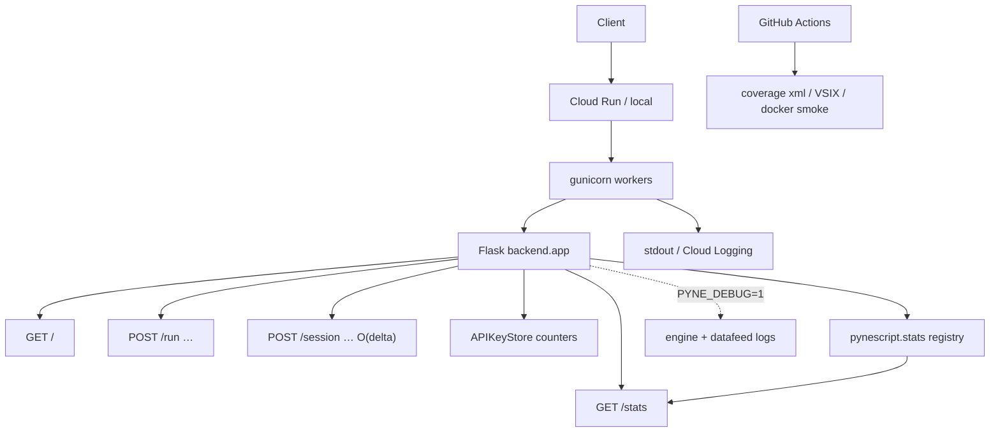

# Copyright (C) 2024-2026 jango_blockchained
#
# This file is part of pynescript.
#
# pynescript is free software: you can redistribute it and/or modify
# it under the terms of the GNU Affero General Public License as published by
# the Free Software Foundation, either version 3 of the License, or
# (at your option) any later version.
#
# pynescript is distributed in the hope that it will be useful,
# but WITHOUT ANY WARRANTY; without even the implied warranty of
# MERCHANTABILITY or FITNESS FOR A PARTICULAR PURPOSE.  See the
# GNU Affero General Public License for more details.
#
# You should have received a copy of the GNU Affero General Public License
# along with pynescript.  If not, see <https://www.gnu.org/licenses/>.
#
# SPDX-License-Identifier: AGPL-3.0-or-later

---
title: "Observability"
description: "PYNE_DEBUG logging, GET /stats runtime counters, health endpoints, gunicorn process model, Cloud Logging, and operational signals."
---

# Observability

## Abstract

PYNE’s production surface today optimizes for **simple, hostable signals** rather than a full OpenTelemetry mesh: HTTP health checks, **development debug logging** (`PYNE_DEBUG`), **process-wide runtime counters** (`GET /stats`), process managers (gunicorn), cloud platform logs, CI artifacts (coverage, Playwright reports), and application-level API key usage counters. Treat this page as the map of *what exists in-repo*, not a claim of enterprise APM parity.

## Conceptual model



## Interface surface

### Health

`backend/app.py` exposes:

```http
GET /
→ { "status": "healthy", "service": "pynescript-pro-api", … }
```

Used by:

- `Dockerfile` target `api` `HEALTHCHECK` (`curl -fsS http://127.0.0.1:8080/`)
- `docker-compose.yml` api healthcheck
- Load balancers / Cloud Run startup-ish probes (platform-dependent)

### Runtime statistics

```http
GET /stats        # public, no API key
→ { counters, latencies, gauges, compile_cache, sessions, debug }
```

Counters, latency percentiles (avg/min/max/p50/p95), and gauges for requests, runs, interpreter, compile, prewarm, live-session deltas, sessions, and datafeed. **Process-local** — resets on worker restart. Full reference: [GET /stats](/pyne/docs/api/endpoints/stats).

```bash
curl -s http://127.0.0.1:5002/stats | python -m json.tool
```

### Debug logging (`PYNE_DEBUG`)

A single development-only flag turns on detailed logging across the execution engine and the datafeed:

```bash
PYNE_DEBUG=1 python -m backend.app
PYNE_DEBUG=1 PYNE_DEBUG_SCOPE=pynescript.runtime,pynescript.compiler python -m backend.app
```

| Variable | Default | Effect |
| --- | --- | --- |
| `PYNE_DEBUG` | off | `DEBUG` on `pynescript` / `backend` loggers + all engine/datafeed instrumentation |
| `PYNE_DEBUG_SCOPE` | *(empty)* | Comma-separated logger allowlist; empty means no filter. Only consulted while `PYNE_DEBUG` is on. |

What it traces:

| Area | Logged |
| --- | --- |
| **Interpreter** | Bar-loop start/end with bars + ms + bars/ms; order-fill and runtime aborts with bar index/time; timeout breaks |
| **Compile** | Eligibility and the reason; host cache `HIT`/`MISS`; transpile (IR key, plots, object mode); JIT warm; nopython fallback |
| **Prewarm** | Builtins warm duration, per-script results, totals, failures |
| **Delta calculation** | `append_bars` delta size + start index; `update_last_bar` tick duration |
| **Datafeed** | CCXT Pro connect/subscribe/first updates/reconnects; REST `fetch_ohlcv` symbol normalization and bar counts; the `/datafeed/*` gateway; `WS /datafeed/watch` connect/close |
| **Best-effort host plumbing** | Intentionally swallowed errors surface as `ignored <what> (<Exc>) in <fn>()` — metrics, realtime scope snapshot/restore, plot-column extension, strategy-history commit, drawing/alert export |
| **HTTP** | Every request: method, path, status, duration; slow requests flagged |

`PYNE_DEBUG=1 POST /run` on a fresh process, for example:

```text
DEBUG pynescript.runtime.host:  auto: eligibility src=2de7f37e3736 eligible=True reason= (cached_failure=False)
DEBUG pynescript.compiler.engine: prewarm: warming shared Numba builtins (first touch, JIT)
DEBUG pynescript.compiler.engine: prewarm: builtins warm in 7497.6ms
DEBUG pynescript.runtime.host:  compile: MISS src=2de7f37e3736 … in 8973.67ms host_cache_entries=1
DEBUG pynescript.runtime.host:  run finished mode=compile bars=40 total=8974.63ms parse=8973.67ms eval=0.06ms
```

A warm second run shows the cache doing its job:

```text
DEBUG pynescript.runtime.host:  compile: HIT src=2de7f37e3736 … in 0.00ms host_cache_entries=1
DEBUG pynescript.runtime.host:  run finished mode=compile bars=40 total=0.36ms parse=0.00ms eval=0.04ms
```

And a live session shows the O(delta) property directly:

```text
DEBUG pynescript.runtime.host:  append_bars run_id=250985e340… delta=2 start=20 new_total=22
DEBUG pynescript.runtime.host:  bar-loop start run_id=250985e340… start=20 end=22 bars=2 total_bars=22
DEBUG pynescript.runtime.host:  update_last_bar run_id=250985e340… idx=21 bar_time=… n_bars=22
```

<Warning>
`PYNE_DEBUG` is **development only** and verbose by design — it is meant to flood. Third-party loggers (`urllib3`, `numba`, `matplotlib`, `asyncio`, `werkzeug`) are held at `WARNING` while it is on. Keep it off in production: the numbers you want there come from `GET /stats`.
</Warning>

Implementation is three small pieces:

| Path | Role |
| --- | --- |
| `src/pynescript/debug.py` | Env toggle, memoized on the raw env string so a live flip takes effect without a restart |
| `src/pynescript/stats.py` | Dependency-free metric registry |
| `backend/logging_setup.py` | Level policy, handler install, `debug_report()` |

The toggle is read at run / batch / request boundaries, never inside a per-bar loop, and log payloads are only built when the flag is on.

### Process model (production)

```text
gunicorn --bind :8080 --workers 2 --threads 4 --timeout 120 backend.app:app
# docker/entrypoint-api.sh: GUNICORN_TIMEOUT default 120
# docker-compose.prod.yml: GUNICORN_TIMEOUT default 60
```

| Knob | Effect on signals |
| --- | --- |
| workers | Process isolation; multiplies memory |
| threads | Concurrent requests within worker |
| timeout | Entrypoint default **120s**. A platform request limit tighter than that wins unless `GUNICORN_TIMEOUT` matches it. |

### Logs

| Environment | Where logs go |
| --- | --- |
| Local `make run` | Process stdout/stderr |
| Docker | Container logs (`docker logs`, compose) |

Application modules use standard library / Flask logging patterns; there is no mandatory structured-log schema enforced repo-wide. `{/* TODO: verify */}` if a future branch introduces OpenTelemetry exporters.

### CI / quality signals

| Signal | Source |
| --- | --- |
| Ruff / mypy | `CI` lint job |
| Pytest results | runtime + LSP + backend steps in `CI` |
| Codecov (optional) | Python 3.13 matrix cell |
| VSIX | `CI` `vscode-ext-test` artifact |
| Docker smoke | `CI` api health + admin 403; CLI `--help` / `info` / `check` |

### Usage metering (app-layer)

`backend/middleware/auth.py` tracks per-key:

- `calls_used` / `calls_limit` / tier
- `last_used` timestamps

These are **business metrics** for rate limits, not Prometheus time series — export them if you need dashboards.

## Internals

| Path | Role |
| --- | --- |
| `backend/app.py` | Health route, `/stats`, request hooks, CORS, `MAX_CONTENT_LENGTH` |
| `backend/logging_setup.py` | `PYNE_DEBUG` level policy, handler install, `debug_report()` |
| `src/pynescript/debug.py` | Debug toggle + `PYNE_DEBUG_SCOPE` filter |
| `src/pynescript/stats.py` | Counter / latency / gauge registry behind `/stats` |
| `src/pynescript/runtime/host.py` | Interpreter, compile, delta debug + stats call sites |
| `src/pynescript/compiler/engine.py` | Compile / prewarm debug + stats call sites |
| `src/pynescript/util/datafeed.py` · `util/data.py` | Datafeed / provider debug + stats call sites |
| `backend/middleware/auth.py` | Key store, rate limit counters |
| `backend/middleware/sessions.py` | Live-session store + lifecycle counters |
| `backend/services/backtest.py` | Backtest metrics objects for API responses |
| `Dockerfile` (`api` target) | HEALTHCHECK + gunicorn entrypoint |
| `logs/` (repo) | Local combined/error log files if generated by tools — not the production contract |

## Invariants & edge cases

1. **Health ≠ readiness of evaluator warm caches.** A 200 on `/` does not mean the first `/run` will be fast (cold import / JIT / numba). Check `compile.host_prewarmed` / call `POST /compile/prewarm`.
2. **`/stats` is per-process, not fleet-wide.** Behind a load balancer each worker counts only its own slice. Aggregate per worker, or run single-worker (which live sessions require anyway).
3. **Timeouts double-bind.** A platform request limit shorter than gunicorn's default 120s wins unless `GUNICORN_TIMEOUT` is set to that limit.
4. **Scale-to-zero hides idle metrics.** No traffic ⇒ no samples; use synthetic uptime checks if SLOs matter.
5. **Coverage artifacts expire** (7–14 days retention on Actions uploads).
6. **Do not scrape secrets from logs.** API keys and admin tokens must never be logged at info level. `PYNE_DEBUG` logs *whether* credentials were supplied, never their values.
7. **Latency percentiles are recent-window.** `p50_ms` / `p95_ms` come from the last 512 samples; `max_ms` is all-time.

## Worked examples

### Local health + stats loop

```bash
make run
curl -s http://127.0.0.1:5002/    | python -m json.tool
curl -s http://127.0.0.1:5002/stats | python -m json.tool
```

### Explain a slow run

```bash
PYNE_DEBUG=1 PYNE_DEBUG_SCOPE=pynescript.runtime,pynescript.compiler make run
# in another shell:
curl -s -X POST http://127.0.0.1:5002/run -H 'Content-Type: application/json' \
  -d '{"script":"//@version=6\nindicator(\"x\")\nplot(ta.sma(close,20))","data":[...]}'
```

Read the trace bottom-up: eligibility → cache HIT/MISS → JIT warm duration → `run finished total=…`. A first run paying ~9 s in `prewarm: builtins warm` and `compile: MISS` is expected; the second identical request should be a `compile: HIT` in ~0 ms.

### Inspect live-session delta stats

```bash
curl -s http://127.0.0.1:5002/stats \
  | jq '{delta: .counters["delta.bars_appended"], appends: .counters["delta.append_calls"],
         max: .gauges["delta.bars_per_append_max"], loop: .latencies["interpret.bar_loop"]}'
```

A large `delta.bars_per_append_max` with a small `interpret.bar_loop.p95_ms` means the delta path is behaving as intended.

### Docker health

```bash
docker inspect --format='{{json .State.Health}}' CONTAINER
```

## Failure modes

| Symptom | Cause | Fix |
| --- | --- | --- |
| Health green, `/run` 500 | Exception in evaluator path | Inspect request logs; reproduce with payload |
| First `/run` takes seconds | Cold Numba JIT | `POST /compile/prewarm` at deploy; confirm on `/health` `compile.host_prewarmed` |
| `/stats` counters reset | Worker restarted | Expected — in-process by design |
| `/stats` counts look low | Multiple workers, per-process counters | Aggregate per worker or set `GUNICORN_WORKERS=1` |
| No engine debug output | `PYNE_DEBUG` not set in the worker process | Set it in the environment, not only in your shell — gunicorn inherits from its parent |
| Too much debug output | No scope filter | Set `PYNE_DEBUG_SCOPE` to the modules you are debugging |
| Worker kills | Soft timeout | Optimize script / raise timeout consistently |
| Missing CI artifact | Path wrong / tests passed | `if-no-files-found: ignore` hides absence |
| Rate limit false positives | Shared key / limit too low | Adjust tier limits; multi-key |

## See also

- [Docker](/pyne/docs/devops/docker)
- [Security](/pyne/docs/devops/security)
- [API lifecycle](/pyne/docs/api/app-lifecycle)
