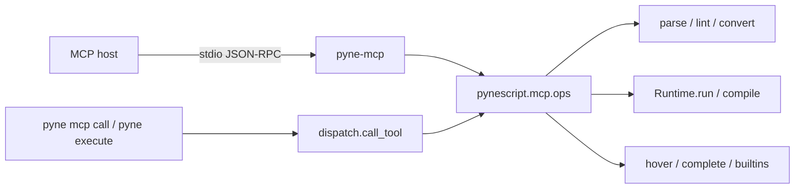

# Copyright (C) 2024-2026 jango_blockchained
#
# This file is part of pynescript.
#
# pynescript is free software: you can redistribute it and/or modify
# it under the terms of the GNU Affero General Public License as published by
# the Free Software Foundation, either version 3 of the License, or
# (at your option) any later version.
#
# pynescript is distributed in the hope that it will be useful,
# but WITHOUT ANY WARRANTY; without even the implied warranty of
# MERCHANTABILITY or FITNESS FOR A PARTICULAR PURPOSE.  See the
# GNU Affero General Public License for more details.
#
# You should have received a copy of the GNU Affero General Public License
# along with pynescript.  If not, see <https://www.gnu.org/licenses/>.
#
# SPDX-License-Identifier: AGPL-3.0-or-later

---
title: "MCP (agents)"
description: "PYNE MCP: stdio pyne-mcp for LLM hosts, plus in-process pyne mcp call and pyne execute (Runtime.run) with no extra."
---

# MCP (agents)

## Abstract

The **PYNE MCP server** exposes the Pine toolchain to LLM hosts (Cursor, Claude, Inspector, Grok) over stdio. The same tools run from the shell with **`pyne mcp call`** and first-class **`pyne execute`** (no MCP SDK). Tools call library APIs in-process — they do not shell out. Stdio serving needs `hoox-pyne[mcp]`; `call` / `execute` / `config` / `tools` do not. Tool names are prefixed `pyne_` so they never collide with AXIS `axis_*` / `app_*`.

## Conceptual model



| Surface | Role |
| --- | --- |
| PYNE MCP | Language + runtime: parse, lint, convert, compile, execute, builtins |
| AXIS MCP | Chart PWA + Worker APIs (`POST /mcp`, optional tab bridge) |
| `pyne-lsp` | Editor language server (separate stdio process) |

Clients may enable PYNE MCP and AXIS MCP together.

## Interface surface

```bash
pip install "hoox-pyne[mcp]"
pyne mcp config          # print mcpServers JSON
pyne mcp tools           # catalog names
pyne mcp call lint script.pine
pyne mcp call execute script.pine --arg bars=50 --arg mode=interpret
pyne execute script.pine --mode interpret --bars 50
pyne mcp                 # stdio (blocks)
pyne-mcp                 # same as pyne mcp
python -m pynescript.mcp
```

```json
{
  "mcpServers": {
    "pyne": {
      "command": "pyne-mcp",
      "args": []
    }
  }
}
```

`pyne mcp config --module` uses `python -m pynescript.mcp` instead of the console script.

`pyne mcp call` and `pyne execute` / `symbols` / `parity` / `diagnostics` / `builtin` invoke the same ops in-process and print JSON (no stdio host, no `mcp` extra). TOOL may be `pyne_lint` or the short alias `lint`. Extra arguments: `--arg KEY=VALUE` (JSON-coerced) or `--json '{"bars":50}'`.

Every tool returns `{ "ok": true, ... }` or `{ "ok": false, "error", "kind", "line?", "column?" }`. Pine syntax errors are tool results, not protocol failures. Prefer `source=` (pasted script) over `path=`. Plot series are truncated (last N samples). Default data provider is `mock`. Runner tools use `PYNE_API_URL` / `ADMIN_TOKEN` and hit the network.

Catalog: [MCP tools](/pyne/docs/enduser/reference/mcp-tools).

## Internals (repo paths)

- `src/pynescript/mcp/catalog.py` — canonical tool / resource / prompt names (docs + tests)
- `src/pynescript/mcp/server.py` — `MCPServer`, tool registration
- `src/pynescript/mcp/dispatch.py` — in-process `call_tool` (CLI `pyne mcp call`)
- `src/pynescript/mcp/cli.py` — Click `mcp` group + `execute` / `symbols` / `parity` / `diagnostics` / `builtin`
- `src/pynescript/mcp/ops/` — library-backed operations
- Extra: `[mcp]` in `pyproject.toml` (`mcp>=2.0,<3`, `lsprotocol`); surfaces `pyne-mcp` / `pyne mcp`
- Entry: `pyne-mcp = pynescript.mcp.__main__:main`

## Invariants & edge cases

- No disk writes (`format` / `convert` return source).
- `pyne_run` is the CLI compile + synthetic bars path. `pyne_execute` is `Runtime.run` (interpret / compile / auto, caller OHLCV, timeout).
- `pyne_download_builtins` **lists** pine-facade templates; it does not write files.
- Hover / complete / signature reuse LSP handlers; they need `lsprotocol` (pulled in by `[mcp]`).

## Worked examples

```text
User: lint this script and run 50 bars
Agent: pyne_lint({source}) → pyne_run({source, bars: 50})
```

```text
User: what does ta.sma take?
Agent: pyne_builtin({name: "ta.sma"})
```

## Failure modes

| Symptom | Cause |
| --- | --- |
| `MCP extra missing` | `pip install "hoox-pyne[mcp]"` for stdio. `pyne execute` / `mcp call` run without the extra |
| `ok: false`, `kind: parse` | Syntax error; `line` / `column` set when known |
| `kind: network` | Runner / non-mock `pyne_data` / facade list |
| Large plot dumps | Raise `sample` only as needed (max 64) |

## See also

- [MCP tools](/pyne/docs/enduser/reference/mcp-tools)
- [CLI guide](/pyne/docs/enduser/guides/cli)
- [Library API](/pyne/docs/enduser/guides/library-api)
- [AXIS MCP](/axis/docs/enduser/guides/mcp)
