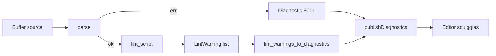

# Copyright (C) 2024-2026 jango_blockchained
#
# This file is part of pynescript.
#
# pynescript is free software: you can redistribute it and/or modify
# it under the terms of the GNU Affero General Public License as published by
# the Free Software Foundation, either version 3 of the License, or
# (at your option) any later version.
#
# pynescript is distributed in the hope that it will be useful,
# but WITHOUT ANY WARRANTY; without even the implied warranty of
# MERCHANTABILITY or FITNESS FOR A PARTICULAR PURPOSE.  See the
# GNU Affero General Public License for more details.
#
# You should have received a copy of the GNU Affero General Public License
# along with pynescript.  If not, see <https://www.gnu.org/licenses/>.
#
# SPDX-License-Identifier: AGPL-3.0-or-later

---
title: "Diagnostics"
description: "Push and pull diagnostics: parse errors, lint rules, opt-in semantic checks, severity mapping, and W001/W002/W101/W104/W105/C002 QuickFixes."
---

# Diagnostics

## Abstract

Diagnostics are the primary static feedback channel. The workspace re-parses and re-lints on every open/change/save, converts `LintWarning` objects (and parse failures) into `lsp.Diagnostic`, then **pushes** them with `textDocument/publishDiagnostics`. Clients that support LSP 3.16+ pull diagnostics can also request `textDocument/diagnostic` or `workspace/diagnostic`.

## Conceptual model



## Interface surface

### Push (always on)

Triggered from `server.py` on `didOpen`, `didChange`, `didSave`. Close clears diagnostics (`items=[]`).

### Pull

| Method | Response |
| --- | --- |
| `textDocument/diagnostic` | `RelatedFullDocumentDiagnosticReport` with `kind=full`, `result_id="{uri}-{version}"` |
| `workspace/diagnostic` | One `WorkspaceFullDocumentDiagnosticReport` per open URI |

Capability: `diagnostic_provider` with `identifier="pynescript-diagnostics"`, `inter_file_dependencies=False`.

### Diagnostic shape

| Field | Value |
| --- | --- |
| `range` | Exact token range when the rule supplies `column`/`end_column`; otherwise line start to line end (capped) |
| `severity` | error / warning / information / hint |
| `message` | Human-readable lint or parse message |
| `source` | `"pyne"` |
| `code` | Lint code (e.g. `W001`) or `E001` for parse errors |

The richer conversion in `features/diagnostics.py` also supports:

- `code_description` hrefs for codes starting with `E` / `W` (docs URLs)
- `tags`: `W002` → Deprecated

Push and pull both call `Workspace._lint_warnings_to_diagnostics`, which delegates lint rows to `features/diagnostics.lint_warnings_to_diagnostics` (noise filters + tags) and then appends synthetic **E001** for parse failures.

## Internals

| Path | Role |
| --- | --- |
| `src/pynescript/langserver/workspace.py` | `_parse_and_lint`, E001 append, incremental edits |
| `src/pynescript/langserver/features/diagnostics.py` | Lint conversion, C001 noise filter, tags, `create_quick_fix` |
| `src/pynescript/ast/linter.py` | Rule engine producing `LintWarning` |

### Severity map

```text
error        → DiagnosticSeverity.Error
warning      → Warning
info|information → Information
hint         → Hint
(default)    → Warning
```

### Version gating

Correctness rules that only apply to v6 are gated on `//@version=6`:

- **W104** (`transp=` / `strategy.* when=`) — valid in v4/v5, removed in v6.
- **W105** (numeric literal in a boolean position) — v6 strictness only.

Unversioned snippets skip both. This prevents the common false-positive flood on
v5 scripts while still nudging v6 migrations.

### Style diagnostics

C001 (naming), C002 (line length), and C004 (trailing newline) are style-only.
The VS Code extension defaults `pynescript.diagnostics.style` to `false`; set it
to `true` to show them. Correctness diagnostics are unaffected.

### Semantic diagnostics (opt-in)

`pynescript.diagnostics.semantic` (default `false`) enables checks that are
decidable from declarations in the current file:

| Code | Finding |
| --- | --- |
| `S001` | Unknown field/method on a user `type`, or unknown member on a user `enum` |
| `S002` | User-function call mismatch: too many positional arguments, missing required arguments, unknown named argument |

Builtin calls, member access on inferred-but-unknown receivers, and method
calls are deliberately skipped. The catalog is incomplete for some host
builtins, so under-reporting is preferred to a speculative error. Semantic
checks only run when the buffer parses.

### Parse errors

On exception from `parse`:

- `ast = None`, `diagnostics = []` (lint skipped)
- Message stored as the parser's short message (no caret dump)
- Synthetic diagnostic code **E001**, severity Error
- Range from `SyntaxErrorDetails` (`lineno`/`offset`/`end_*`), clamped to a
  non-empty span on the last non-empty line for EOF errors

### Quick fixes (feature module)

`create_quick_fix` is wired through `textDocument/codeAction` (`server.py` → `convert.handle_code_action`) for **W001**, **W002**, **W101**, **W104**, **W105**, and **C002**:

- **W001** (missing `//@version`) → QuickFix inserting `//@version=6\n` at document start (line 0, character 0). Offered even when Convert-to-v6 is also available (undeclared version is treated as v1 for convert).
- **W002** (`//@version=N` with N < 5) → QuickFix replacing the existing pragma **line** with `//@version=6` (does not insert a second pragma). v5 does not emit W002; Convert-to-v6 still applies.
- **W101** (v4 `security(...)` spelling) → QuickFix replacing the `security` token with `request.security`, verified by re-parsing.
- **W104** (`transp=` / `strategy.* when=` removed in v6) → QuickFix deleting the named argument and one separating comma. The AST supplies the argument and value ranges; multi-line calls are handled. The fix is not offered when the removed span contains a comment (never trade a lint fix for deleted text) or when the rewritten buffer would not parse.
- **W105** (numeric literal in a boolean position) → QuickFix rewriting the literal as `literal != 0`, preserving Pine truthiness while satisfying v6 strictness. Applied to `if`, `while`, and ternary conditions; the fix is verified by re-parsing.
- **C002** (line longer than 120 characters) → QuickFix applying the same whole-document `TextEdit` as `textDocument/formatting` (`handle_formatting` / `NodeUnparser`). Kind is `QuickFix`. Offered only when lint warnings include C002 (not invented). Parse failure, an already-canonical buffer, or a buffer containing prose/block comments (which the unparser would drop) yields no C002 fix. Convert-to-v6 / W001 / W002 are unchanged.

Capability advertises `QuickFix` and `RefactorRewrite` (Convert-to-v6). A v6 script that already has `//@version=6` has no W001/W002; C002 is still offered when the linter reports a long line and formatting would change the buffer.

## Invariants and edge cases

1. **Lint does not run when parse fails** — only E001 is shown.
2. Warnings without a line number are dropped (`None` conversion).
3. Rules supply exact token columns where practical (W104/W105/W101/C001); otherwise the end column falls back to the remainder of the line and clamps to 2000 characters.
4. `inter_file_dependencies=False`: no cross-file analysis; each URI is independent.
5. Push and pull should agree for a given buffer version; both read the same `TextDocumentState`. Published diagnostics carry the document `version` so a stale debounce result cannot overwrite a newer buffer.
6. **Noise filters:** comments and string literals are masked before regex rules (W101/C001); `C001` on names that already lack `_` (camelCase `fastMA`) is dropped. The `C003` block-`if` noise filter was removed with the rule (retired 0.6.0).
7. **Style rules are opt-in in the extension.** They remain available to CLI users and other LSP clients.
8. **Semantic diagnostics are opt-in and conservative.** Only user-declared types/enums and user functions are checked; builtin arity and unknown identifiers are not guessed.
9. **C002 is not invented** — unlike W001/W002, a format QuickFix is emitted only when `warnings` contains C002, and only when formatting produces an edit.

## Worked example

Source:

```pinescript
indicator("x")
plot(close)
```

If the linter emits a missing-version warning (code `W001`), the client receives a Warning diagnostic on the relevant line with `source: "pyne"`. `textDocument/codeAction` also returns a preferred QuickFix that inserts `//@version=6` at the top of the buffer.

A script with `//@version=4` gets W002 (deprecated) and a preferred QuickFix that replaces that pragma line with `//@version=6`. Convert-to-v6 remains a separate `RefactorRewrite`. v5 is not W002.

On a hard parse failure at line 3, expect:

```json
{
  "severity": 1,
  "code": "E001",
  "source": "pyne",
  "message": "<exception text>"
}
```

## Failure modes

| Symptom | Cause |
| --- | --- |
| Stale squiggles after edit | Client using full-document sync incorrectly, or version mismatch |
| Empty diagnostics on broken file | Unexpected: parse errors should still emit E001 — check client filter on `source` |
| No workspace pull results | Only **open** documents are tracked; closed files are absent |

## See also

- [Linter (core)](/pyne/docs/core/linter)
- [Error model](/pyne/docs/core/error-model)
- [Architecture](/pyne/docs/lsp/architecture)
