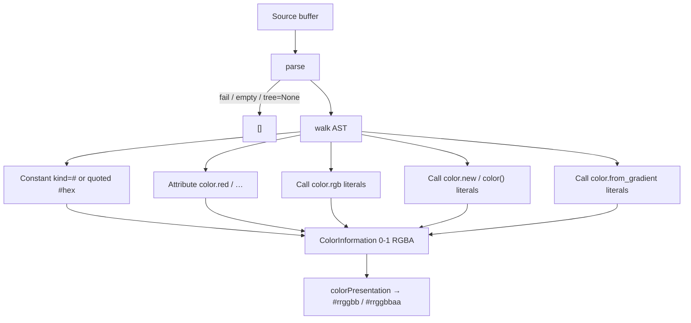

# Copyright (C) 2024-2026 jango_blockchained
#
# This file is part of pynescript.
#
# pynescript is free software: you can redistribute it and/or modify
# it under the terms of the GNU Affero General Public License as published by
# the Free Software Foundation, either version 3 of the License, or
# (at your option) any later version.
#
# pynescript is distributed in the hope that it will be useful,
# but WITHOUT ANY WARRANTY; without even the implied warranty of
# MERCHANTABILITY or FITNESS FOR A PARTICULAR PURPOSE.  See the
# GNU Affero General Public License for more details.
#
# You should have received a copy of the GNU Affero General Public License
# along with pynescript.  If not, see <https://www.gnu.org/licenses/>.
#
# SPDX-License-Identifier: AGPL-3.0-or-later

---
title: "Document color"
description: "textDocument/documentColor and colorPresentation for #hex, color.*, and literal color calls."
---

# Document color

## Abstract

`textDocument/documentColor` reports editor color swatches for Pine color literals. Each hit is a 0–1 RGBA `ColorInformation` covering the AST node. `textDocument/colorPresentation` rewrites the requested range as `#rrggbb` (or `#rrggbbaa` when alpha ≠ 1), including when the original text was a `color.*` name. Empty source or parse failure returns `[]`.

## Conceptual model



Only **literal** values become swatches. A `color.rgb(x, 0, 0)` whose `x` is a name is skipped; a nested `color.blue` inside a skipped call still gets its own swatch.

## Interface surface

| Method | Handler |
| --- | --- |
| `textDocument/documentColor` | `handle_document_color` |
| `textDocument/colorPresentation` | `handle_color_presentation` |

Capability: `color_provider=True` (`config.py`). `handle_document_color` receives the version-matched AST (`tree=doc.valid_ast`).

Returns `[]` for empty source, parse failure, or `tree=None`. Never `None`.

### Reported swatches

| Form | Example | Notes |
| --- | --- | --- |
| Lexer `COLOR` token | `#ff0000`, `#00ff00aa`, `#f0a` | `Constant` with `kind="#"`; `#rgb` expands each nibble (`#f0a` → `ff00aaff`) |
| Quoted hex string | `"#ff0000"`, `"#00ff00aa"` | `Constant` with `kind is None`; range **includes the quotes** |
| Named `color.*` | `color.red`, `color.green` | `Attribute` on `Name("color")`; palette from `_NAMED_COLORS` |
| `color.rgb` | `color.rgb(255, 0, 0[, transp])` | Numeric literals only; optional Pine transp 0–100 (0 = opaque) |
| `color.new` | `color.new(color.white, 50)` | Both args literals (named / `#hex` / quoted hex + numeric transp) |
| `color()` | `color(#ff0000, 25)` | Pine alias of `color.new` |
| `color.from_gradient` | `color.from_gradient(5, 0, 10, #000000, #ffffff)` | All five args literals; interpolation matches interpret `color.from_gradient` |

`#rrggbb` is opaque (alpha 1). `#rrggbbaa` sets alpha from the last byte. Channels are 0–255, divided by 255 for the LSP `Color`.

### Pine transparency

`color.rgb` / `color.new` / `color()` take **transp 0–100**, where **0 is opaque**. Alpha byte = `round(255 * (1 - transp / 100))`. Example: transp `50` → alpha `128`; transp `95` → alpha `13`.

Keyword aliases on `color.rgb`: `r`/`g`/`b`/`t` for `red`/`green`/`blue`/`transp`. `from_gradient` accepts evaluator aliases (`min` / `max` / `color1` / `color2`, …).

### colorPresentation

Rewrites `params.range` as hex. `source` is unused — the client already sent the color and range.

| Alpha | Label / `newText` |
| --- | --- |
| 1 (`255`) | `#rrggbb` (lowercase) |
| otherwise | `#rrggbbaa` |

Picking a color on `color.red` therefore replaces the name with `#f23645`. There is no presentation that keeps the `color.*` spelling.

## Internals

| Path | Role |
| --- | --- |
| `src/pynescript/langserver/features/document_color.py` | Walk + RGBA conversion + presentation |
| `src/pynescript/ast/evaluator/builtins/color.py` | `_NAMED_COLORS`, `color_from_gradient` |
| `src/pynescript/langserver/config.py` | `color_provider=True` |
| `src/pynescript/langserver/server.py` | `TEXT_DOCUMENT_DOCUMENT_COLOR` / `TEXT_DOCUMENT_COLOR_PRESENTATION`; color list cached on `doc.feature_cache["document_color"]` |

Named palette (hex as stored): `red` `#F23645`, `green` `#22AB94`, `blue` `#2962FF`, `black`, `white`, `gray`/`grey`, `orange`, `purple`, `yellow`, `aqua`, `fuchsia`, `lime`, `maroon`, `navy`, `olive`, `silver`, `teal`.

`from_gradient` lerp matches interpret: RGBA interpolate, clamp `value` to `[min, max]`, equal min/max → color1.

Tests: `tests/test_lsp_features.py` (`TestDocumentColorHandler`).

## Invariants and edge cases

1. **Empty / unparsed → `[]`.** Missing source, parse exception, or `tree=None`.
2. **Non-literal args skip the call**, not nested literals. `color.rgb(x, 0, 0)` is not a swatch; `color.blue` inside a skipped `color.rgb(color.r(color.blue), …)` still is.
3. **Unknown `color.foo` / `color.r` are not swatches.** Only names in `_NAMED_COLORS`.
4. **`color.new` / `color()` need both args.** One-arg `color.new(color.white)` is skipped. Extra args skip the call. Nested `color.rgb(...)` as the color arg is not a literal color.
5. **Quoted non-hex strings are ignored.** `"not-a-color"` and `"ff0000"` (no `#`) are not swatches.
6. **Presentation always hex.** Named ranges become `#rrggbb` / `#rrggbbaa`; the handler does not emit `color.red` as a presentation label.
7. **Hash comments vs colors.** `#ff0000` is a color token; `# hash …` is a comment (see [document links](/pyne/docs/lsp/features/document-link)).

## Worked example

```pinescript
//@version=6
indicator("T")
c1 = #ff0000
c2 = #00ff00aa
plot(close, color=#2962FF)
bgcolor(#22AB94)
plot(close, title="#ff00ff")
col = color.red
c = color.rgb(255, 0, 0)
d = color.rgb(33, 150, 243, 95)
n = color.new(color.white, 50)
g = color.from_gradient(5, 0, 10, #000000, #ffffff)
```

Expected swatches (0–1 RGBA, 8-bit shown):

| Text | RGB (alpha) |
| --- | --- |
| `#ff0000` | 255, 0, 0 (255) |
| `#00ff00aa` | 0, 255, 0 (170) |
| `#2962FF` | 41, 98, 255 |
| `#22AB94` | 34, 171, 148 |
| `"#ff00ff"` | 255, 0, 255 (range includes quotes) |
| `color.red` | 242, 54, 69 (`#F23645`) |
| `color.rgb(255, 0, 0)` | 255, 0, 0 |
| `color.rgb(33, 150, 243, 95)` | 33, 150, 243 (13) |
| `color.new(color.white, 50)` | 255, 255, 255 (128) |
| `color.from_gradient(5, 0, 10, #000000, #ffffff)` | 127, 127, 127 (midpoint) |

`colorPresentation` on `#ff0000` with opaque red yields label `#ff0000`. On `color.red` with the palette red, the edit replaces the name with `#f23645`.

Not swatches: `color.rgb(x, 0, 0)`, `color.from_gradient(close, 0, 100, color.red, color.green)`, `color.new(color.white)` (missing transp).

## Failure modes

| Symptom | Cause |
| --- | --- |
| No swatches on file | Parse error → `[]` |
| `color.rgb(close, 0, 0)` has no picker | Non-literal args — expected skip |
| Picking a color on `color.red` rewrites hex | Expected: presentation is always `#rrggbb` / `#rrggbbaa` |
| Quoted `"#ff0000"` picker covers the quotes | Expected: range is the whole string Constant |
| Gradient swatch disagrees with chart | Call args were not all literals, or min/max equal (then color1) |

## See also

- [Document links](/pyne/docs/lsp/features/document-link) — hash comments vs `#hex` tokens
- [Inlay hints](/pyne/docs/lsp/features/inlay-hints) — `color.*` return types on assignments
- [Architecture](/pyne/docs/lsp/architecture) — `color_provider=True`
