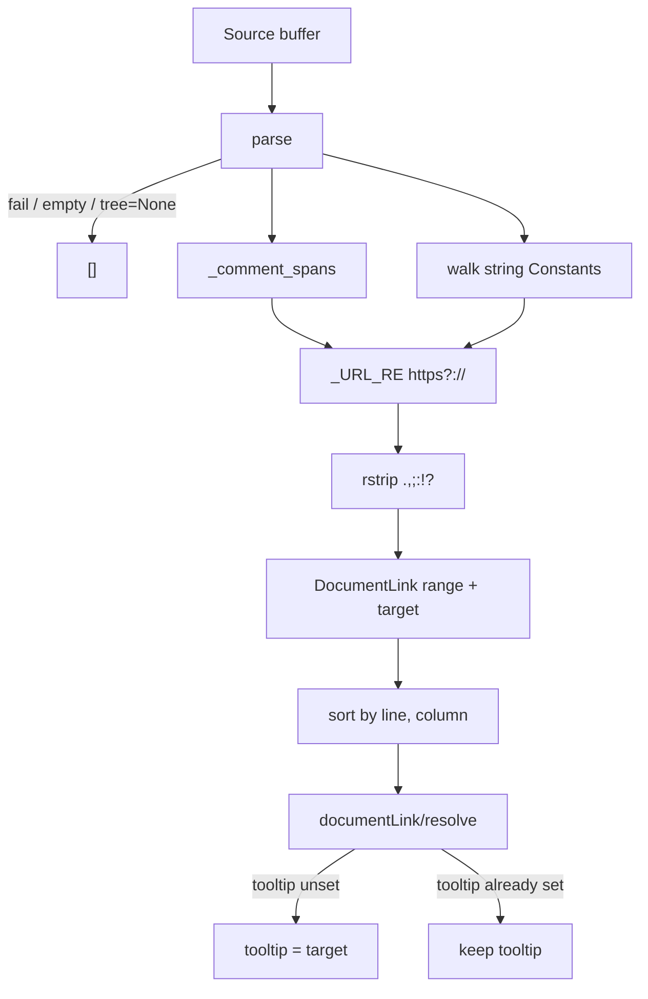

# Copyright (C) 2024-2026 jango_blockchained
#
# This file is part of pynescript.
#
# pynescript is free software: you can redistribute it and/or modify
# it under the terms of the GNU Affero General Public License as published by
# the Free Software Foundation, either version 3 of the License, or
# (at your option) any later version.
#
# pynescript is distributed in the hope that it will be useful,
# but WITHOUT ANY WARRANTY; without even the implied warranty of
# MERCHANTABILITY or FITNESS FOR A PARTICULAR PURPOSE.  See the
# GNU Affero General Public License for more details.
#
# You should have received a copy of the GNU Affero General Public License
# along with pynescript.  If not, see <https://www.gnu.org/licenses/>.
#
# SPDX-License-Identifier: AGPL-3.0-or-later

---
title: "Document links"
description: "textDocument/documentLink for http(s) URLs in comments and strings, and documentLink/resolve tooltip."
---

# Document links

## Abstract

`textDocument/documentLink` reports `http://` / `https://` URLs found in comments (`//`, `/* */`, hash `# …`) and string literals. Each match is a `DocumentLink` whose range is the URL (not the surrounding quotes or comment markers) and whose `target` is that URL. Empty source or parse failure returns `[]`. The first response leaves `tooltip` unset; `documentLink/resolve` copies the URL onto `tooltip` when it is unset so clients can show it on hover. Advertised as `DocumentLinkOptions(resolve_provider=True)`.

## Conceptual model



Comments are scanned from the raw buffer so they do not need AST nodes. String URLs come from `Constant` nodes whose `value` is a `str`. Hash comments are distinguished from `#rgb` color tokens: `#` followed by a hex digit is a color, not a comment.

## Interface surface

| Method | Capability |
| --- | --- |
| `textDocument/documentLink` | `DocumentLinkOptions(resolve_provider=True)` |
| `documentLink/resolve` | fills `tooltip` with the URL when tooltip is unset |

Handlers: `features/document_link.py` → `handle_document_link` (receives version-matched `tree=doc.valid_ast`) and `handle_document_link_resolve`.

Each initial result:

| Field | Value |
| --- | --- |
| `range` | LSP range covering the URL text |
| `target` | The URL string (`http://` or `https://`) |
| `tooltip` | unset (`None`) until resolve |

Returns `[]` for empty source, parse failure, or `tree=None`.

### Where URLs are collected

| Region | Source |
| --- | --- |
| `//` line comments | Raw buffer, through the newline (or EOF) |
| `/* */` block comments | Raw buffer, including the closers; unclosed blocks run to EOF |
| Hash `# …` comments | Raw buffer, when `#` is not a `#rgb` color token |
| String literals | AST `Constant` with a `str` value; range is the URL inside the quotes |

The matcher is `http://` or `https://` followed by non-whitespace characters excluding `<>"'` and `*`. Trailing `.,;:!?` is stripped from both the range and the `target` (`// see https://example.com/end.` → `https://example.com/end`).

Not collected:

- `ftp://…`, scheme-less `www.example.com`, or other non-`http(s)` schemes
- URLs in identifier / number tokens (only comments and string Constants)
- `#hex` color literals (they are not hash comments)

### Resolve

`documentLink/resolve` fills `tooltip` with the link `target` URL:

1. An existing tooltip is kept (already-resolved links are returned unchanged).
2. When tooltip is unset and `target` is a non-empty string, `tooltip` is set to that URL.
3. Empty or malformed links are returned unchanged (never raises).

Initial `textDocument/documentLink` responses already carry `target`. Resolve copies that URL onto `tooltip` so clients can show it on hover.

## Internals

| Path | Role |
| --- | --- |
| `src/pynescript/langserver/features/document_link.py` | Comment scan + string walk + resolve |
| `src/pynescript/langserver/config.py` | `DocumentLinkOptions(resolve_provider=True)` |
| `src/pynescript/langserver/server.py` | `TEXT_DOCUMENT_DOCUMENT_LINK` (cached on `doc.feature_cache["document_link"]`); `DOCUMENT_LINK_RESOLVE` |

The workspace cache supplies `tree=doc.valid_ast`. Pass `tree=None` when the last parse failed (skips a redundant re-parse). Omit `tree` only in isolated tests (handler then parses from `source`). Comments need the source text; a pre-parsed tree with `source=None` still yields string-literal links.

Tests: `tests/test_lsp_features.py` (`TestDocumentLinkHandler`).

## Invariants and edge cases

1. **Empty / unparsed → `[]`.** Missing source, parse exception, or `tree=None` never returns `None`.
2. **Range is the URL, not the quotes.** `"https://example.com"` highlights `https://example.com`.
3. **Trailing punctuation is not part of the link.** `https://example.com/end.` strips the period.
4. **Hash comments vs colors.** `# hash https://…` is a comment; `#ff0000` is a color token and is not scanned as a comment.
5. **Results are sorted** by start line, then start column.
6. **Workspace cache.** The server stores the `textDocument/documentLink` result on `feature_cache` until the buffer changes. Resolve is not cached; it fills `tooltip` on the link the client sends back.
7. **Resolve fills tooltip only when unset.** An existing tooltip is kept; empty or malformed links are returned as-is and never throw.

## Worked example

```pinescript
//@version=6
indicator("T")
// docs: https://example.com/pine
url = "https://tradingview.com/pine-script-docs"
also = 'http://example.org/path'
/* block https://example.com/block and https://example.com/two */
# hash https://example.com/hash
// trailing https://example.com/end.
plot(close)
```

Expected links (`target` equals the range text; `tooltip` is unset until resolve):

- `https://example.com/pine`
- `https://tradingview.com/pine-script-docs`
- `http://example.org/path`
- `https://example.com/block`
- `https://example.com/two`
- `https://example.com/hash`
- `https://example.com/end` (period not included)

After `documentLink/resolve`, each of those links has `tooltip` equal to `target` (for example `https://example.com/pine`). A client that already set a tooltip keeps that string.

`ftp://example.com` and `www.example.com` in a comment produce no links.

## Failure modes

| Symptom | Cause |
| --- | --- |
| No clickable URLs | Parse failed (`[]`), or the URL is not `http(s)` |
| Link includes a trailing period | Client ignored the range and used line text; the server strips `.,;:!?` |
| Comment URL missing, string URL present | Handler ran with `source=None` and a cached tree — comments need the buffer |
| `#ff0000` not a link | Expected: hash color tokens are not comments |
| Hover over a link shows no tooltip | Client skipped `documentLink/resolve`, or the link had no `target` |
| Tooltip overwritten | Not expected: resolve keeps an existing tooltip |

## See also

- [Document color](/pyne/docs/lsp/features/document-color) — `#hex` vs hash comments
- [Architecture](/pyne/docs/lsp/architecture) — declared capabilities and AST cache
- [Hover](/pyne/docs/lsp/features/hover) — Pine v6 function-reference links on builtin cards
