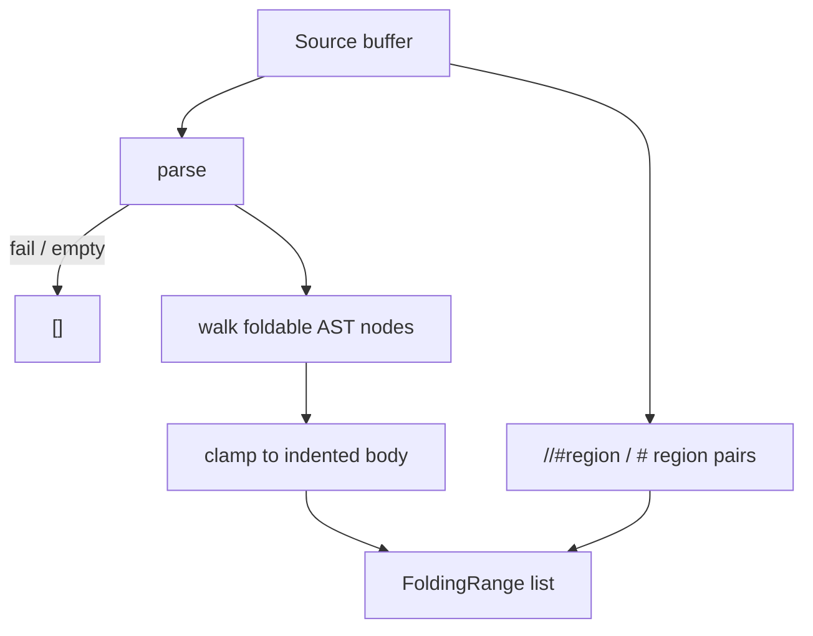

# Copyright (C) 2024-2026 jango_blockchained
#
# This file is part of pynescript.
#
# pynescript is free software: you can redistribute it and/or modify
# it under the terms of the GNU Affero General Public License as published by
# the Free Software Foundation, either version 3 of the License, or
# (at your option) any later version.
#
# pynescript is distributed in the hope that it will be useful,
# but WITHOUT ANY WARRANTY; without even the implied warranty of
# MERCHANTABILITY or FITNESS FOR A PARTICULAR PURPOSE.  See the
# GNU Affero General Public License for more details.
#
# You should have received a copy of the GNU Affero General Public License
# along with pynescript.  If not, see <https://www.gnu.org/licenses/>.
#
# SPDX-License-Identifier: AGPL-3.0-or-later

---
title: "Folding ranges"
description: "textDocument/foldingRange for Pine blocks, type/enum/function bodies, and //#region comments."
---

# Folding ranges

## Abstract

`textDocument/foldingRange` folds indented Pine blocks so editors can collapse `if` / `for` / `while` / `switch` / `once`, `FunctionDef` / `TypeDef` / `EnumDef`, and `//#region` … `//#endregion` pairs. Empty or unparsed documents return `[]`.

## Conceptual model

Control blocks are expressions (`If`, `ForTo`, `ForIn`, `While`, `Switch`, `Once`) and often sit under `Expr`. The walker visits the inner node. Parser `end_lineno` can land on the next statement, so the handler prefers the indented body when source lines are available (`else` at the header indent continues an `if`). Single-line constructs are skipped.

## Interface surface

- Method: `textDocument/foldingRange`
- Capability: `folding_range_provider=True`
- Handler: `features/folding.py` → `handle_folding_range` (receives version-matched `tree=doc.valid_ast`)

Each range uses 0-based `start_line` / `end_line`. Region comment pairs set `kind: "region"`.

| Construct | Folded |
| --- | --- |
| `if` / `else if` / `else` | keyword line through the last indented body line |
| `for` … `to` / `for` … `in` | same |
| `while` / `switch` / `once` | same |
| `FunctionDef` / `TypeDef` / `EnumDef` | declaration through last body line |
| `//#region` … `//#endregion` | start through end marker (`# region` / `# endregion` too) |

Returns `[]` for empty source, parse failure, or `tree=None`.

## Internals

| Path | Role |
| --- | --- |
| `src/pynescript/langserver/features/folding.py` | AST walk + indent clamp + region scan |
| `src/pynescript/langserver/config.py` | `folding_range_provider=True` |
| `src/pynescript/langserver/server.py` | `TEXT_DOCUMENT_FOLDING_RANGE` handler |

Tests: `tests/test_lsp_features.py`.

## See also

- [Architecture](/pyne/docs/lsp/architecture) — declared capabilities
- [Selection ranges](/pyne/docs/lsp/features/selection-range) — expand selection over the same blocks
- [Navigation](/pyne/docs/lsp/features/navigation) — outline symbols share AST line spans
