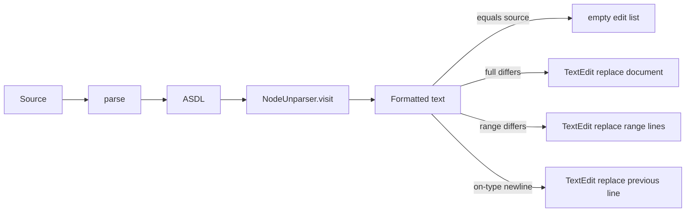

# Copyright (C) 2024-2026 jango_blockchained
#
# This file is part of pynescript.
#
# pynescript is free software: you can redistribute it and/or modify
# it under the terms of the GNU Affero General Public License as published by
# the Free Software Foundation, either version 3 of the License, or
# (at your option) any later version.
#
# pynescript is distributed in the hope that it will be useful,
# but WITHOUT ANY WARRANTY; without even the implied warranty of
# MERCHANTABILITY or FITNESS FOR A PARTICULAR PURPOSE.  See the
# GNU Affero General Public License for more details.
#
# You should have received a copy of the GNU Affero General Public License
# along with pynescript.  If not, see <https://www.gnu.org/licenses/>.
#
# SPDX-License-Identifier: AGPL-3.0-or-later

---
title: "Formatting"
description: "Document, range, and on-type formatting via AST parse → NodeUnparser round-trip."
---

# Formatting

## Abstract

Formatting is **canonical unparse**, not a style linter. The handler parses the buffer, runs `NodeUnparser`, and if the result differs from the source, replaces the document (or the requested line range, or the just-completed line) with a single `TextEdit`. There is no prettier-like option matrix; `FormattingOptions` from the client are currently unused.

**Safety rule:** the ASDL AST keeps Pine annotations (`//@version`, `//@function`, …) but not ordinary prose or block comments. If the buffer contains a comment the unparser would drop, formatting returns **no edits** instead of deleting user text. A comment-preserving formatter is future work.

## Conceptual model



## Interface surface

| Method | Handler |
| --- | --- |
| `textDocument/formatting` | `handle_formatting` |
| `textDocument/rangeFormatting` | `handle_range_formatting` |
| `textDocument/onTypeFormatting` | `handle_on_type_formatting` |

Capabilities (`config.py`): both document providers `True`; on-type advertised as `documentOnTypeFormattingProvider` with `firstTriggerCharacter = "\n"`.

### Full document

1. Parse with filename `"<format>"`.
2. `formatted = NodeUnparser().visit(tree)`.
3. If identical to source → `[]`.
4. Else one `TextEdit` spanning `(0,0)` → last line/col with `new_text=formatted`.

### Range

1. Unparse the **entire** document.
2. Slice **formatted** lines and **source** lines by the client range’s start/end line indices.
3. If the in-range slices match → `[]`.
4. Else replace `params.range` with the formatted line slice.

This is line-aligned, not AST-node-aligned: partial mid-line ranges may produce surprising splices when unparse changes line structure.

### On-type (after `\n`)

After the client inserts a newline, `params.position` is the cursor on the **new** line and `params.ch` is `"\n"`. The handler formats the **previous** line (or line 0) via the same `NodeUnparser` and, when that line differs, returns one `TextEdit` covering only that source line.

1. Empty source, `ch != "\n"`, or `tree=None` (workspace parse already failed) → `[]`.
2. Unparse the whole document.
3. `target = max(0, params.position.line - 1)`.
4. If the target is past either line list, or the formatted line equals the source line → `[]`.
5. Else replace `[target, 0) → [target, len(source_line))` with the formatted line.

Triggers other than newline are ignored. The advertised trigger is `"\n"`.

## Internals

| Path | Role |
| --- | --- |
| `features/formatting.py` | LSP handlers |
| `src/pynescript/ast/helper.py` | `parse` |
| `src/pynescript/ast/unparser.py` | `NodeUnparser` |

VS Code command `pynescript.formatDocument` delegates to `editor.action.formatDocument`, which hits this provider when the language client is active. Format-on-type is the client’s `onTypeFormatting` request after Enter.

## Invariants and edge cases

1. **Parse failure → `[]`** (no partial format; silent no-op from the client’s perspective). On-type also no-ops when the workspace already failed to parse (`tree=None`).
2. **Idempotence goal:** format twice should stabilize if unparse is canonical; any non-idempotent unparse is a core bug, not an LSP bug.
3. **Comments / trivia:** Pine annotations are preserved; prose/block comments block formatting (no destructive edit). This is not a full CST pretty-printer.
4. **Range and on-type** require a full successful parse and matching line counts; only the edit span is clipped. If unparse changes line structure, no range/on-type edit is returned.
5. Tab size / insert spaces from `FormattingOptions` are ignored today.
6. **On-type is previous-line only** — the new empty line under the cursor is not rewritten.

## Worked example

Before:

```pinescript
//@version=6
indicator("x")
plot(  close  )
```

After full format (illustrative — exact whitespace follows `NodeUnparser`):

```pinescript
//@version=6
indicator("x")
plot(close)
```

If source already matches unparse output, the server returns an empty edit list and the editor leaves the buffer alone.

On-type: typing Enter after a compact assignment `length=14` (cursor now at the start of the next line) yields one edit on that assignment line: `length = 14`.

## Failure modes

| Symptom | Cause |
| --- | --- |
| Format does nothing on broken syntax | Expected: exception → `[]` |
| Range format rewrites wrong lines | Unparse shifted line count; prefer full-document format |
| On-type after Enter does nothing | Unknown trigger, unparsed buffer, or the previous line already matches unparse |
| Client “format on save” loops | Unparse not idempotent — fix unparser, not client |

## See also

- [Unparser](/pyne/docs/core/unparser)
- [Architecture](/pyne/docs/lsp/architecture)
- [VS Code extension](/pyne/docs/lsp/vscode-extension)
