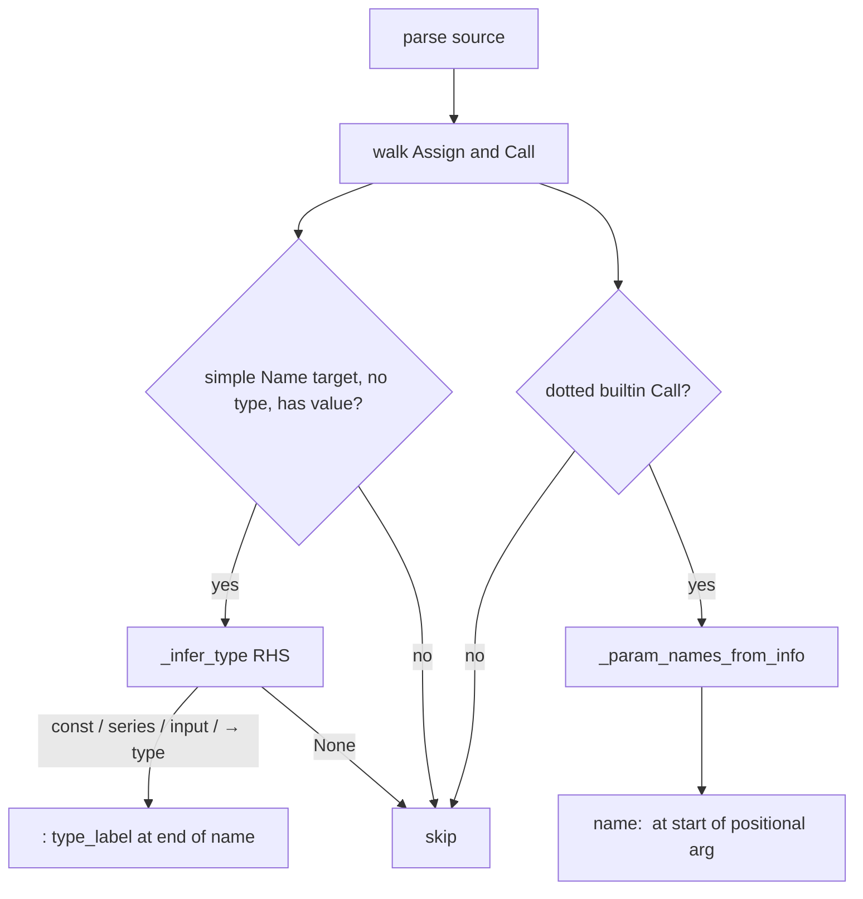

# Copyright (C) 2024-2026 jango_blockchained
#
# This file is part of pynescript.
#
# pynescript is free software: you can redistribute it and/or modify
# it under the terms of the GNU Affero General Public License as published by
# the Free Software Foundation, either version 3 of the License, or
# (at your option) any later version.
#
# pynescript is distributed in the hope that it will be useful,
# but WITHOUT ANY WARRANTY; without even the implied warranty of
# MERCHANTABILITY or FITNESS FOR A PARTICULAR PURPOSE.  See the
# GNU Affero General Public License for more details.
#
# You should have received a copy of the GNU Affero General Public License
# along with pynescript.  If not, see <https://www.gnu.org/licenses/>.
#
# SPDX-License-Identifier: AGPL-3.0-or-later

---
title: "Inlay Hints"
description: "Display-only assignment type annotations and builtin parameter names. Hints never insert text or modify the document."
---

# Inlay Hints

## Abstract

Inlay hints surface two things: **inferred types** next to simple `name = expr` assignments when no explicit type annotation is present, and **parameter names** before positional arguments of builtin and user function/method calls (`ta.sma(close, 14)` → `source:` / `length:`). Inference uses the scope-aware symbol index first (annotated declarations, UDT fields/methods, user return types, builtin metadata) and falls back to the shallow constant/`input.*`/`ta.*` rules. Ambiguous operators are skipped rather than guessed wrong. Hints are filtered to the client's requested range. **Hints are display-only:** the server does not advertise or implement `inlayHint/resolve`, emits no `data`, and never sets `textEdits`, so an inferred type can never be injected into the source.

## Conceptual model



Example mental model (from module docstring):

```text
length = 14                 →  length: const int
rsi = ta.rsi(close, 14)     →  rsi: series float   (from metadata detail)
n = input.int(5, "n")       →  n: input int
ta.sma(close, 14)           →  ta.sma(source: close, length: 14)
```

## Interface surface

| Method | Capability |
| --- | --- |
| `textDocument/inlayHint` | `InlayHintOptions(resolve_provider=False)` |

Handler: `features/inlay_hints.py` → `handle_inlay_hints` (receives the version-matched `tree=doc.valid_ast`). There is no `inlayHint/resolve` handler and no document mutation path.

### Assignment type hints

| Field | Value |
| --- | --- |
| `position` | End of target identifier (`lineno-1`, `col_offset + len(id)`) |
| `label` | `": {type_label}"` |
| `kind` | `InlayHintKind.Type` |
| `tooltip` | `Inferred type: {type_label}` |
| `data` | omitted |
| `textEdits` | omitted (display-only) |

### Parameter-name hints

Emitted for positional args of `module.attr(...)` when `get_builtin("module.attr")` hits. Real snippet placeholder names win; generic `paramN` snippets fall through to the longest of the `detail` signature, documentation, and a well-known Pine v6 map (`ta.sma`/`ema`/`rsi` → `source`/`length`, `ta.atr` → `length`, `ta.correlation` → `source1`/`source2`/`length`, `strategy.entry` → `id`/`direction`/`qty`, `input.int` → `defval`/`title`, plus `ta.cci`/`roc`/`mom`/`linreg`/`adx`/`mfi`/`bbw`/`dpo`/`crossover`/`crossunder`).

| Field | Value |
| --- | --- |
| `position` | Start of the positional argument |
| `label` | `"{name}: "` |
| `kind` | `InlayHintKind.Parameter` |
| `data` | omitted |
| `textEdits` | omitted (display-only) |

Named kwargs (`length=14`) skip the matching slot.

`handle_inlay_hints` returns `[]` for empty source, `None` if parse fails (client typically treats as no hints).

## Internals

### Constant mapping

| Python value | Label |
| --- | --- |
| `bool` | `const bool` |
| `int` | `const int` |
| `float` | `const float` |
| `str` | `const string` |

### Builtin bare names

`open`, `high`, `low`, `close`, `volume`, `hl2`, `hlc3`, `ohlc4` → `series float`; time / bar index vars → `series int`; `na` → `na`.

### Calls

- `input.{int,float,bool,string,color,symbol,session,source,time,timeframe,price}` → `input {attr}`
- `ta|math|str|color.{attr}` → parse `detail` after `→`, else fallback `"series"`

### Walk

Recursive over `_fields` (same pattern as workspace symbol collection) — not limited to script top-level; nested function assigns and nested calls can receive hints.

| Path | Role |
| --- | --- |
| `features/inlay_hints.py` | Collection + inference (display-only) |
| `providers/builtin_metadata.py` | Return-type detail and parameter names |

## Invariants and edge cases

1. **Explicit `name: type = …` suppresses type hints** (`node.type is not None`).
2. **Tuple / attribute targets** are ignored for type hints.
3. **BinOp / Compare / Conditional** return `None` — no speculative arithmetic types.
4. **Metadata quality bounds accuracy** — missing `→` in detail yields coarse `series`; missing param names yields no parameter hints.
5. **Hints never mutate the document.** No `textEdits`, no `data`, no resolve handler; applying a hint is a client-side display action only.
6. **Malformed input does not throw** — unparsable or empty sources return `None` / `[]`.

## Worked example

```pinescript
//@version=6
indicator("hints")
length = 14
src = close
avg = ta.sma(src, length)
period = input.int(20, "Period")
```

Expected hints (when parse + metadata succeed):

- `length` → `: const int` (type)
- `src` → `: series float`
- `avg` → type from `ta.sma` detail (typically series float) or `series`
- `period` → `: input int`
- `ta.sma(src, length)` → `source:` before `src`, `length:` before `length`

`avg` will not get a hint derived from `length`’s type through the call graph — only the call’s known return shape. Clicking a hint never edits the call or the declaration.

## Failure modes

| Symptom | Cause |
| --- | --- |
| No hints on file | Parse error → `None` |
| `ta.*` always `: series` | Metadata detail lacks `→` segment |
| No `source:` / `length:` on a builtin call | Not a dotted builtin, named kwargs, or metadata/snippet names missing |
| Applying a hint does nothing | Expected: hints are display-only; there is no type injection |
| Hints mid-identifier | Incorrect `col_offset` on AST node — builder issue |

## See also

- [Completion](/pyne/docs/lsp/features/completion)
- [Builtin metadata](/pyne/docs/lsp/builtin-metadata)
- [Type system](/pyne/docs/core/type-system)
