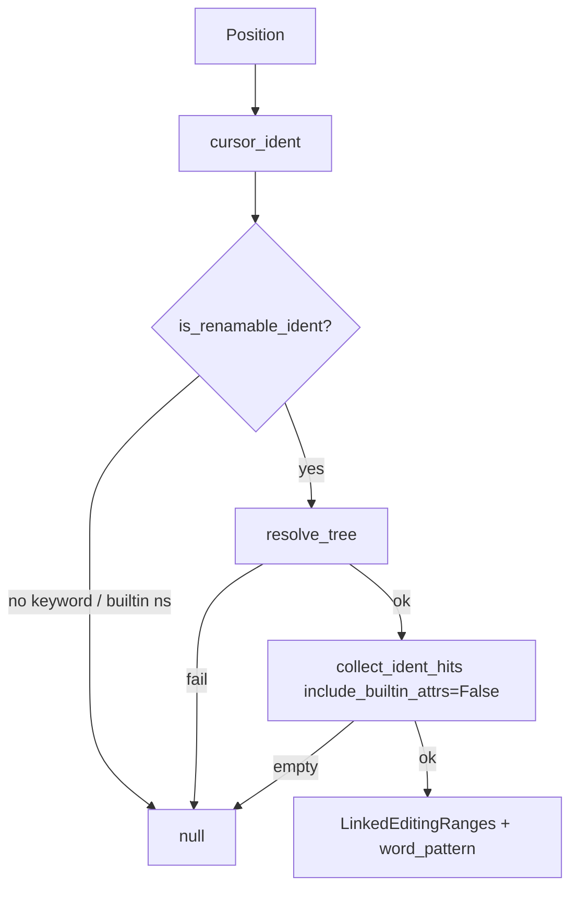

# Copyright (C) 2024-2026 jango_blockchained
#
# This file is part of pynescript.
#
# pynescript is free software: you can redistribute it and/or modify
# it under the terms of the GNU Affero General Public License as published by
# the Free Software Foundation, either version 3 of the License, or
# (at your option) any later version.
#
# pynescript is distributed in the hope that it will be useful,
# but WITHOUT ANY WARRANTY; without even the implied warranty of
# MERCHANTABILITY or FITNESS FOR A PARTICULAR PURPOSE.  See the
# GNU Affero General Public License for more details.
#
# You should have received a copy of the GNU Affero General Public License
# along with pynescript.  If not, see <https://www.gnu.org/licenses/>.
#
# SPDX-License-Identifier: AGPL-3.0-or-later

---
title: "Linked editing"
description: "textDocument/linkedEditingRange — live multi-cursor ranges for user identifiers."
---

# Linked editing

## Abstract

`textDocument/linkedEditingRange` returns same-document ranges for the **resolved user symbol** under the cursor so the client can drive live multi-cursor edits (rename-as-you-type). Resolution uses the scope-aware symbol index, so a shadowed local is not linked to a same-named global. Keywords, builtin namespaces, and unresolved identifiers stay unlinked — the same refusal set as [rename](/pyne/docs/lsp/features/navigation). Empty buffers, unparsed documents, and non-renamable tokens return `null`.

## Conceptual model



## Interface surface

- Method: `textDocument/linkedEditingRange`
- Capability: `linked_editing_range_provider=True`
- Handler: `features/linked_editing.py` → `handle_linked_editing_range` (receives version-matched `tree=doc.valid_ast`)

Response:

| Field | Value |
| --- | --- |
| `ranges` | Character-precise `Range` list for every same-document occurrence of the ident |
| `wordPattern` | `[A-Za-z_][A-Za-z0-9_]*` |

Unlike `textDocument/rename`, linked editing is **one document** — it does not walk other open buffers.

### What is unlinked

`is_renamable_ident` (shared with highlight / rename) returns false for:

- Empty or invalid tokens (not a single Pine ident)
- Keywords from `PINE_KEYWORDS` (`if`, `plot`, `enum`, …)
- Builtin namespaces (`ta`, `strategy`, `math`, `input`, `request`, `str`, `array`, `matrix`, `map`, `color`, `line`, `label`, `box`, `table`, `polyline`, `log`, `chart`, `runtime`, `session`, `time`, `barstate`, `syminfo`, `timeframe`, `ticker`, `alert`, `hline`, …)
- Dotted words whose head is a builtin namespace (`ta.sma` as a whole)

Hits are collected with `include_builtin_attrs=False`, so library attributes are not linked when the cursor is on a user ident.

## Internals

| Path | Role |
| --- | --- |
| `features/linked_editing.py` | LSP handler + `WORD_PATTERN` |
| `langserver/analysis.py` | Scope/symbol resolution and exact occurrence ranges |
| `features/highlight.py` | `cursor_ident`, `is_renamable_ident` |
| `config.py` | `linked_editing_range_provider=True` |
| `server.py` | `TEXT_DOCUMENT_LINKED_EDITING_RANGE` |

Tests: `tests/test_lsp_features.py` (`TestLinkedEditingRangeHandler`).

## Invariants and edge cases

1. **No source → null.** Missing or empty buffer aborts early.
2. **Keywords and builtin namespaces never link.** Cursor on `ta`, `plot`, or `if` yields `null`.
3. **Parse failure → null.** `tree=None` (workspace already failed) skips a redundant re-parse.
4. **Same-document only.** Cross-file live edits are rename’s job (open documents), not linked editing.
5. **`wordPattern` is the Pine ident token** — the client should not extend the edit into `.` or digits-leading junk.

## Worked example

```pinescript
//@version=6
indicator("t")
length = 14
plot(ta.sma(close, length))
```

Cursor on either `length`: two ranges (the assignment target and the call argument), `wordPattern` `[A-Za-z_][A-Za-z0-9_]*`. Cursor on `ta` or `plot`: `null`.

## Failure modes

| Symptom | Cause |
| --- | --- |
| Linked editing never starts | Cursor on a keyword / builtin namespace, or parse failed |
| Only one occurrence linked | Other hits are a different ident, or builtin attrs excluded |
| Edit spills into neighboring text | Client ignored `wordPattern` |

## See also

- [Navigation](/pyne/docs/lsp/features/navigation) — highlight and rename share the ident collector
- [Architecture](/pyne/docs/lsp/architecture)
- [Hover](/pyne/docs/lsp/features/hover) — builtins vs user symbols
