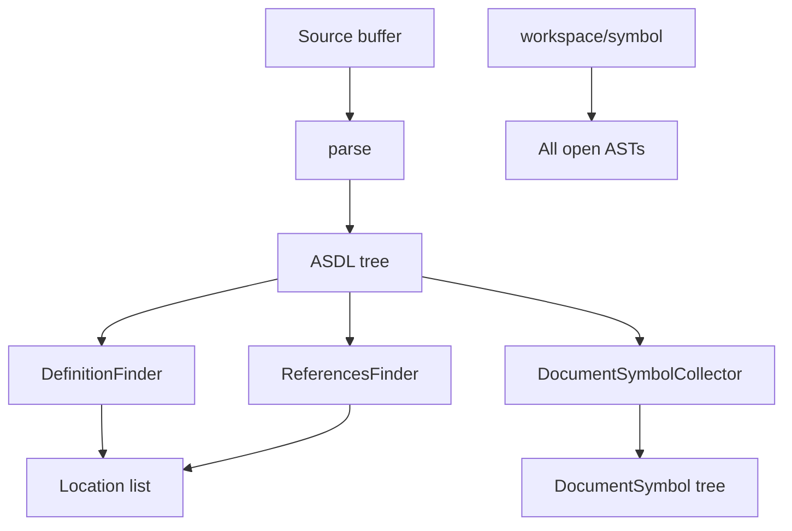

# Copyright (C) 2024-2026 jango_blockchained
#
# This file is part of pynescript.
#
# pynescript is free software: you can redistribute it and/or modify
# it under the terms of the GNU Affero General Public License as published by
# the Free Software Foundation, either version 3 of the License, or
# (at your option) any later version.
#
# pynescript is distributed in the hope that it will be useful,
# but WITHOUT ANY WARRANTY; without even the implied warranty of
# MERCHANTABILITY or FITNESS FOR A PARTICULAR PURPOSE.  See the
# GNU Affero General Public License for more details.
#
# You should have received a copy of the GNU Affero General Public License
# along with pynescript.  If not, see <https://www.gnu.org/licenses/>.
#
# SPDX-License-Identifier: AGPL-3.0-or-later

---
title: "Navigation"
description: "Go-to-definition, find-references, document highlight, rename across open documents, document outline, and workspace symbol search over the ASDL AST."
---

# Navigation

## Abstract

Navigation features operate on **user AST symbols**, not the builtin catalog. A shared static index (`langserver/analysis.py`) builds Pine scopes, declarations, member references, exact identifier ranges, and conservative types. Definition/references/highlight/rename resolve the symbol under the cursor through that index, so shadowed locals and unrelated same-named fields are not conflated. Definition and reference locations are character-precise. Rename applies to every **currently open** workspace document (script-level names also match other open scripts); document symbols build a hierarchical outline; workspace symbols include open documents plus a bounded index of closed Pine files under the workspace roots.

## Conceptual model



## Interface surface

| Method | Handler | Returns |
| --- | --- | --- |
| `textDocument/definition` | `definitions.handle_definition` | `list[Location] \| None` |
| `textDocument/references` | `references.handle_references` | `list[Location]` (possibly empty) |
| `textDocument/documentHighlight` | `highlight.handle_document_highlight` | `list[DocumentHighlight]` |
| `textDocument/prepareRename` | `rename.handle_prepare_rename` | `Range \| None` |
| `textDocument/rename` | `rename.handle_rename` | `WorkspaceEdit \| None` (all open documents) |
| `textDocument/documentSymbol` | `symbols.handle_document_symbols` | `list[DocumentSymbol]` |
| `workspace/symbol` | `server._collect_workspace_symbols` | `list[SymbolInformation]` |

Capabilities: `definition_provider`, `references_provider`, `document_highlight_provider`, `rename_provider` (`prepare_provider=True`), document + workspace symbol options with work-done progress flags.

### Definition (`DefinitionFinder`)

Matches target word against:

- `FunctionDef.name`
- `TypeDef.name`
- `Assign` targets (`Name` or nested names)

Ignores mere call sites (`visit_Call` returns early when the callee name matches).

### References (`ReferencesFinder`)

- `Name` with Load / Store contexts
- Function and type definitions when `include_declaration` is true
- Call sites of bare `Name` callees

`params.context.include_declaration` controls whether declarations appear.

### Document symbols

Hierarchical:

| AST | SymbolKind | Children |
| --- | --- | --- |
| `FunctionDef` | Function | Variables assigned inside body |
| `TypeDef` | Class | Fields (`Assign` targets) |
| `EnumDef` | Enum | Members |
| Top-level `Assign` | Variable | — |

Function `detail` is a coarse `function name()` string; assignments may show callee module attribute as detail when RHS is a call.

### Workspace symbols

Flat `SymbolInformation` for functions/methods, types, enums + members, imports, and assigned names. Open buffers are authoritative; closed files under workspace roots are searched through `WorkspaceIndex` (bounded). Filter is a lowercase query substring.

## Internals

| Path | Role |
| --- | --- |
| `features/definitions.py` | Go-to-definition visitor |
| `features/references.py` | Find-all-references visitor |
| `features/highlight.py` | Document highlight + ident occurrence collector |
| `features/rename.py` | prepareRename (cursor document) + rename across open documents |
| `features/symbols.py` | Document outline |
| `server.py` | Workspace symbol aggregation |

Handlers accept the **version-matched AST** (`tree=doc.valid_ast` from `server.py`). They re-parse from `source` only when `tree` is omitted (tests / isolated calls). Pass `tree=None` after a failed parse so the handler does not retry.

## Invariants and edge cases

1. **Parse failure → empty / null** (definition `None`, others `[]`).
2. **Builtin names** have no definition in-file; clients should not expect `ta.sma` to resolve to a library file URI.
3. **Ranges are character-precise** for definition, references, highlight, rename, and document symbols. The analysis layer stores each identifier's exact `(line, column, end_line, end_column)`.
4. **Scopes are modeled** — script, function/method, if/for/while/switch/once, type, and enum. `:=` resolves outward; `=` declares locally. UDT fields/methods and enum members are separate from script variables.
5. **Closed documents** are included in workspace symbol search through the bounded `WorkspaceIndex`, but not in `textDocument/rename` or `references`; those still operate on open buffers. Rename updates every currently open buffer that contains the symbol (script-level names also match other open scripts). `prepareRename` stays the cursor document's ident range.

## Worked example

```pinescript
//@version=6
indicator("nav")
length = 14
mySma(src, len) =>
    ta.sma(src, len)
v = mySma(close, length)
```

- Definition on `mySma` at the call site → function line.
- References on `length` → assign + call argument (and declaration if included).
- Outline → `length` variable, `mySma` function (with locals), `v` variable.

## Failure modes

| Symptom | Cause |
| --- | --- |
| Jump lands column 0 | Expected with current Location encoding |
| Missing references inside function when targeting another function | `visit_FunctionDef` only walks body when the def name **differs** from target — intentional for declaration handling; calls inside same-named functions are a known edge |
| Empty outline | Parse error or empty source |

## See also

- [Architecture](/pyne/docs/lsp/architecture)
- [Hover](/pyne/docs/lsp/features/hover) — builtins vs user symbols
- [Diagnostics](/pyne/docs/lsp/features/diagnostics)
