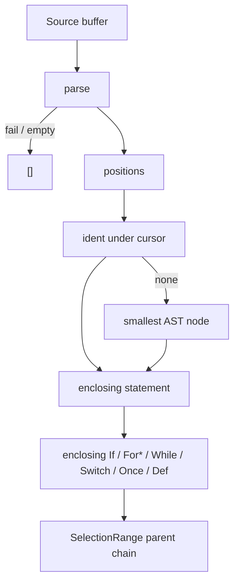

# Copyright (C) 2024-2026 jango_blockchained
#
# This file is part of pynescript.
#
# pynescript is free software: you can redistribute it and/or modify
# it under the terms of the GNU Affero General Public License as published by
# the Free Software Foundation, either version 3 of the License, or
# (at your option) any later version.
#
# pynescript is distributed in the hope that it will be useful,
# but WITHOUT ANY WARRANTY; without even the implied warranty of
# MERCHANTABILITY or FITNESS FOR A PARTICULAR PURPOSE.  See the
# GNU Affero General Public License for more details.
#
# You should have received a copy of the GNU Affero General Public License
# along with pynescript.  If not, see <https://www.gnu.org/licenses/>.
#
# SPDX-License-Identifier: AGPL-3.0-or-later

---
title: "Selection ranges"
description: "textDocument/selectionRange expands from an ident or smallest AST node to the enclosing statement and block."
---

# Selection ranges

## Abstract

`textDocument/selectionRange` grows the editor selection from the identifier (or smallest AST node) under the cursor to the enclosing statement, then enclosing `if` / `for` / `while` / `switch` / `once` blocks and `FunctionDef` / `TypeDef` / `EnumDef`. Empty or unparsed documents, or a position with no node, return `[]`.

## Conceptual model

Control blocks are expressions (`If`, `ForTo`, `ForIn`, `While`, `Switch`, `Once`) and often sit under `Expr`. Duplicate spans (the `Expr` wrapper and the inner block) are collapsed. Nested blocks are linked inner-to-outer so Expand Selection walks ident → statement → inner block → outer block.

## Interface surface

- Method: `textDocument/selectionRange`
- Capability: `selection_range_provider=True`
- Handler: `features/selection_range.py` → `handle_selection_range` (receives version-matched `tree=doc.valid_ast`)

Each result is a `SelectionRange` whose `range` contains the requested position and whose optional `parent` is a strictly larger containing range (LSP exclusive-end ranges from AST `lineno` / `end_lineno` / `col_offset` / `end_col_offset`).

| Layer | Selected |
| --- | --- |
| Innermost | Identifier segment under the cursor, else the smallest AST node |
| Statement | Enclosing `stmt` (`Assign`, `Expr`, `FunctionDef`, …) |
| Block | `If` / `ForTo` / `ForIn` / `While` / `Switch` / `Once` / `FunctionDef` / `TypeDef` / `EnumDef` |

Returns `[]` for empty source, parse failure, `tree=None`, or no node at the position.

## Internals

| Path | Role |
| --- | --- |
| `src/pynescript/langserver/features/selection_range.py` | Ident + AST walk → nested `SelectionRange` |
| `src/pynescript/langserver/config.py` | `selection_range_provider=True` |
| `src/pynescript/langserver/server.py` | `TEXT_DOCUMENT_SELECTION_RANGE` handler |

Tests: `tests/test_lsp_features.py`.

## See also

- [Architecture](/pyne/docs/lsp/architecture) — declared capabilities
- [Folding ranges](/pyne/docs/lsp/features/folding) — same block constructs, line folds
- [Navigation](/pyne/docs/lsp/features/navigation) — outline symbols share AST line spans
