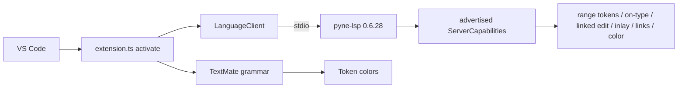

# Copyright (C) 2024-2026 jango_blockchained
#
# This file is part of pynescript.
#
# pynescript is free software: you can redistribute it and/or modify
# it under the terms of the GNU Affero General Public License as published by
# the Free Software Foundation, either version 3 of the License, or
# (at your option) any later version.
#
# pynescript is distributed in the hope that it will be useful,
# but WITHOUT ANY WARRANTY; without even the implied warranty of
# MERCHANTABILITY or FITNESS FOR A PARTICULAR PURPOSE.  See the
# GNU Affero General Public License for more details.
#
# You should have received a copy of the GNU Affero General Public License
# along with pynescript.  If not, see <https://www.gnu.org/licenses/>.
#
# SPDX-License-Identifier: AGPL-3.0-or-later

---
title: "VS Code Extension"
description: "PYNE VS Code extension: LanguageClient host for pyne-lsp, TextMate grammar, snippets, settings, and VSIX 0.5.3."
---

# VS Code Extension

## Abstract

**PYNE** (`hoox-sh.pyne` **0.5.3**) is a **LanguageClient host** plus a rich TextMate grammar, branded as part of the **HOOX open trading stack**. It does **not** reimplement language intelligence in TypeScript — `vscode-languageclient` speaks STDIO to `pyne-lsp` (then alias `pynescript-lsp`, then `python -m pynescript.langserver`) and forwards whatever that process advertises in `initialize`. The VSIX stays **0.5.3**; the hosted Python server is **`hoox-pyne` 0.6.28** (`src/pynescript/__about__.py`). The extension maps **`.pyne` (first-class)** plus `*.pine` / `*.pinev5` / `*.pinev6` / `*.pinescript` to language id `pinescript`, ships **snippets**, and exposes a broad `pynescript.*` settings surface with per-feature toggles.

## Conceptual model



## Interface surface

### Package identity

From `vscode-extension/package.json`:

| Field | Value |
| --- | --- |
| name | `pyne` |
| displayName | `PYNE Language Support` |
| version | `0.5.3` |
| publisher | `hoox-sh` |
| extension id | `hoox-sh.pyne` |
| icon | `media/icon.png` (HOOX mark) |
| engines.vscode | `^1.91.0` |
| main | `./out/extension.js` (esbuild bundle) |
| dependency | `vscode-languageclient` ^10 |
| galleryBanner | `#050505` dark |

### Language contribution

- **id:** `pinescript`
- **aliases:** `PYNE`, `pyne`, `pinescript`, `Pine`
- **extensions:** **`.pyne`** (first), `.pine`, `.pinev5`, `.pinev6`, `.pinescript`
- **configuration:** `language-configuration.json`
- **grammar:** `syntaxes/pinescript.tmLanguage.json` (`scopeName: source.pinescript`) — namespaces, annotations, hex colors, UDT/enum, multiline strings, plot/strategy builtins
- **snippets:** `snippets/pine.code-snippets` — `indicator`, `strategy`, `library`, `type`, `enum`, `input.*`, `plot`, `plotshape`, `ta.*`, `strategy.entry`/`close`, `if`/`for`/`switch`, `request.security`, `label.new`, `array.new<>`, multiline string

### Hosted `pyne-lsp` methods (not reimplemented in TypeScript)

The LanguageClient negotiates capabilities from `src/pynescript/langserver/config.py` (`get_server_capabilities`). The hosted server now advertises the following; the 0.5.3 extension is still only a host, but adds client-side **feature gates** so each capability can be toggled without restarting the server.

| LSP method | What the editor gets | Feature page |
| --- | --- | --- |
| `textDocument/semanticTokens/full` + `/range` | Same legend, range clipped to the viewport | [Semantic tokens](/pyne/docs/lsp/features/semantic-tokens) |
| `textDocument/onTypeFormatting` | Format the just-completed line; trigger `"\n"` | [Formatting](/pyne/docs/lsp/features/formatting) |
| `textDocument/linkedEditingRange` | Same-document live ranges for a user ident (keywords / builtin namespaces refused) | [Linked editing](/pyne/docs/lsp/features/linked-editing) |
| `textDocument/inlayHint` + `inlayHint/resolve` | Assignment type labels; parameter-name hints on dotted builtin calls (`ta.sma(close, 14)` → `source:` / `length:`). Resolve fills type `textEdits` only | [Inlay hints](/pyne/docs/lsp/features/inlay-hints) |
| `textDocument/documentLink` + `documentLink/resolve` | `http://` / `https://` URLs in comments (`//`, `/* */`, hash `# …`) and string literals. Resolve fills `tooltip` with the URL when tooltip is unset | [Document links](/pyne/docs/lsp/features/document-link) |
| `textDocument/documentColor` + `colorPresentation` | `#hex` (and named `color.*` / literal `color.rgb` / `color.new` / `color()` / `color.from_gradient`) swatches; presentation rewrites as `#rrggbb` / `#rrggbbaa` | [Document color](/pyne/docs/lsp/features/document-color) |

Also advertised (unchanged host path): diagnostics, completion + resolve, hover, signature help, definition / references, highlight + rename, document / workspace symbols, full + range formatting, folding, selection range, Convert-to-v6 / W001 / W002 / C002 code actions. Capability table: [Architecture](/pyne/docs/lsp/architecture).

`[pinescript]` configuration defaults already set `editor.semanticHighlighting.enabled` to `true` and `editor.defaultFormatter` to `hoox-sh.pyne`. Format-on-type and linked-editing UX are standard VS Code editor settings (`editor.formatOnType`, `editor.linkedEditing`) — they are **not** `pynescript.*` keys. Enable them if you want Enter to hit `onTypeFormatting` or rename-as-you-type to hit `linkedEditingRange`.

### Activation

```text
onLanguage:pinescript
onCommand:pynescript.restartServer
onCommand:pynescript.formatDocument
onCommand:pynescript.showLspOutput
onCommand:pynescript.showLspCommand
onCommand:pynescript.convertToV6
onCommand:pynescript.diagnosticsToggle
onCommand:pynescript.completionToggle
onCommand:pynescript.inlayHintsToggle
onCommand:pynescript.foldingToggle
onCommand:pynescript.colorPreviewToggle
onCommand:pynescript.toggleHover
onCommand:pynescript.toggleSignatureHelp
onCommand:pynescript.toggleSemanticTokens
onCommand:pynescript.toggleDocumentHighlight
onCommand:pynescript.toggleLinkedEditing
onCommand:pynescript.toggleSelectionRange
onCommand:pynescript.toggleDocumentLink
onCommand:pynescript.toggleCodeAction
onCommand:pynescript.toggleFormatOnSave
onCommand:pynescript.openDocumentLink
onCommand:pynescript.runOnPro
onCommand:pynescript.installLanguageServer
onCommand:pynescript.installBackend
onCommand:pynescript.startBackend
onCommand:pynescript.testBackend
onCommand:pynescript.selectSyntax
workspaceContains:**/*.pyne
workspaceContains:**/*.pine
workspaceContains:**/*.pinev5
workspaceContains:**/*.pinev6
```

### Settings (`pynescript.*`)

#### Appearance

| Key | Default | Meaning |
| --- | --- | --- |
| `pynescript.syntaxHighlighting` | `void` | Pine token palette (TextMate + semantic tokens), independent of the workbench theme. `none` inherits the active theme. |

#### Language server

| Key | Default | Meaning |
| --- | --- | --- |
| `pynescript.lsp.enabled` | `true` | Start the language client |
| `pynescript.lsp.command` | `auto` | `auto` (PATH → module), an absolute binary path, or `docker` |
| `pynescript.lsp.python` | `python3` | Interpreter for `-m pynescript.langserver` |
| `pynescript.lsp.args` | `[]` | Extra server arguments (`docker run` arguments when `command` is `docker`) |

#### Editor features

| Key | Default | Meaning |
| --- | --- | --- |
| `pynescript.formatting.enabled` | `true` | Formatting — full document, selection, on-type |
| `pynescript.formatOnSave.enabled` | `false` | Format on save (requires `formatting.enabled`) |
| `pynescript.diagnostics.enabled` | `true` | Errors, warnings, and hints |
| `pynescript.diagnostics.severity` | `{}` | Remap severity by lint-code prefix, e.g. `{"W": "Hint"}` |
| `pynescript.diagnostics.style` | `false` | Show C001/C002/C004 style findings |
| `pynescript.diagnostics.semantic` | `false` | Reserved opt-in unknown-symbol/arity checks |
| `pynescript.completion.snippets` | `true` | Snippets for builtins and declarations |
| `pynescript.hover.enabled` | `true` | Hover cards (signature, docs, types) |
| `pynescript.inlayHints.types` | `true` | Inferred type hints |
| `pynescript.inlayHints.parameters` | `true` | Parameter-name hints in calls |
| `pynescript.signatureHelp.enabled` | `true` | Parameter hints while typing a call |
| `pynescript.semanticTokens.enabled` | `true` | Semantic token colorization |
| `pynescript.documentHighlight.enabled` | `true` | Highlight other occurrences of an identifier |
| `pynescript.linkedEditing.enabled` | `true` | Rename-as-you-type (needs `editor.linkedEditing`) |
| `pynescript.selectionRange.enabled` | `true` | Smart expand/shrink selection |
| `pynescript.documentLink.enabled` | `true` | Clickable `http(s)` URLs in comments and strings |
| `pynescript.codeAction.enabled` | `true` | Code actions (Convert to v6, `W001` quick fix) |

Feature settings are sent to the server through `workspace/didChangeConfiguration` and take effect without restarting the client. Only `pynescript.lsp.*` changes restart the language server.

#### Installation

| Key | Default | Meaning |
| --- | --- | --- |
| `pynescript.install.autoInstall` | `false` | Install the server with pip when missing, without prompting |
| `pynescript.install.autoPrompt` | `true` | Ask once before installing a missing server |
| `pynescript.install.package` | `hoox-pyne[lsp]` | pip requirement installed by **PYNE: Install Language Server** |
| `pynescript.install.python` | `""` | Python for pip (empty = `lsp.python` → `python3` → `python` → `py`) |
| `pynescript.install.args` | `[]` | Extra pip arguments (e.g. `["--no-cache-dir"]`) |
| `pynescript.install.createVenv` | `true` | Isolated venv when the system Python is PEP 668 managed |
| `pynescript.install.venv` | `""` | Explicit venv directory (empty = extension storage) |

#### Pro & backend

| Key | Default | Meaning |
| --- | --- | --- |
| `pynescript.pro.enabled` | `false` | Enable PYNE Pro (`Run on Pro`) |
| `pynescript.pro.apiKey` | `""` | Pro API key, minted with `POST /auth/create_key`; stored in settings in plain text |
| `pynescript.backend.url` | `http://127.0.0.1:5002` | Self-hosted backend base URL (no `/run`) |
| `pynescript.backend.useHosted` | `false` | Use `pynescript.online` instead of `backend.url` |
| `pynescript.backend.hostedUrl` | `https://pynescript.online` | Hosted backend base URL |
| `pynescript.backend.package` | `hoox-pyne[pro,lsp]` | pip requirement installed by **PYNE: Install Backend (Pro API)** |
| `pynescript.backend.path` | `""` | PYNE checkout for **PYNE: Start Backend** (empty = first workspace folder) |

### Themes (AXIS Void / Hoox Signal / PYNE Volt)

The extension contributes three color themes. Pick one from the normal VS Code
**Preferences: Color Theme** picker — the extension never changes
`workbench.colorTheme` automatically, not on activation and not on install.

| Theme | Accent | Surfaces |
| --- | --- | --- |
| **AXIS Void** | periwinkle `#939FFF` | Near-black with a whisper of indigo; dark-grey panels |
| **Hoox Signal** | signal orange `#FE6A00` | Near-black, neutral surfaces |
| **PYNE Volt** | lime `#B7EF09` | Near-black with a whisper of lime |

Comments are always neutral gray in every theme. Keywords and functions take the accent, strings a light accent tint, numbers the foreground, and punctuation / series builtins gray — so a file stays calm even with a vivid accent.

Pine syntax highlighting is independent of the workbench theme:

| Option | Setting | Values | `none` means |
| --- | --- | --- | --- |
| **Syntax highlighting** | `pynescript.syntaxHighlighting` | `none` · `void` · `signal` · `volt` | Use the active theme's Pine colors |

It writes language-scoped `[pinescript]` token colors, so it composes with any workbench theme — including your own. Switch it with **PYNE: Select Syntax Highlighting** or set the key directly. Default: `void`.

## Invariants and edge cases

1. **`lsp.enabled === false` skips starting the client** — output channel, status bar, and palette commands still register so the palette never shows “command not found”; restart then no-ops until the setting is true.
2. **Binary vs module:** production users should install `hoox-pyne[lsp]` or the Nuitka onefile (`pynescript-lsp-*` on GitHub Releases) and set `pynescript.lsp.command` if not on PATH.
3. **Grammar works without LSP** — open a `.pyne` or `.pine` file offline and still get TextMate highlighting.
4. **`.pyne` is first-class** in `package.json` extensions + activation; legacy `.pine*` / `.pinescript` remain fully supported.
5. File watcher covers every associated suffix (`pyne`, `pine`, `pinev5`, `pinev6`, `pinescript`).
6. **VSIX 0.5.3 does not pin server methods.** Range tokens, on-type format, linked editing, inlay resolve / param names, document links + resolve tooltip, and document color appear only when the spawned `pyne-lsp` is new enough to advertise them (this tree: **0.6.28**). Feature gates are client-side and read live settings.

## Worked example — extension development

```bash
pip install -e ".[lsp]"
cd vscode-extension && npm ci && npm run compile
# Launch Extension Development Host pointing at vscode-extension
```

Open a fixture `.pine` file; confirm Problems panel shows parse/lint diagnostics from the Python server. With a current `pyne-lsp`, also expect `#hex` color swatches, clickable `https://` links in comments, `source:` / `length:` inlay labels on `ta.sma(close, 14)`, and range semantic tokens while scrolling.

## Failure modes

| Symptom | Cause |
| --- | --- |
| “Language client failed to start” | `pyne-lsp` missing / wrong command |
| No squiggles, highlighting OK | LSP disabled or server crash; check Output → PYNE Language Server |
| Restart does nothing | Client never started (`lsp.enabled` false) |
| No inlay param names / color swatches / document links | Spawned `pyne-lsp` is older than this tree (need **0.6.28**) |
| Enter does not reformat the previous line | `editor.formatOnType` is off (not a `pynescript.*` key) |
| Identifiers do not multi-cursor as you type | `editor.linkedEditing` is off (not a `pynescript.*` key) |
| A feature does nothing after toggling | Its `pynescript.<feature>.enabled` key is `false` |
| **Run on Pro** says “disabled” | Set `pynescript.pro.enabled` (and `pro.apiKey` for hosted) |
| **Run on Pro** request fails | Check `pynescript.backend.url` / `backend.useHosted` (base URL, no `/run`) and that the backend is reachable |

## See also

- [Architecture](/pyne/docs/lsp/architecture) — declared `ServerCapabilities`
- [Semantic tokens](/pyne/docs/lsp/features/semantic-tokens) — full and range
- [Formatting](/pyne/docs/lsp/features/formatting) — full, range, and on-type (`\n`)
- [Linked editing](/pyne/docs/lsp/features/linked-editing)
- [Inlay hints](/pyne/docs/lsp/features/inlay-hints) — types, param names, resolve
- [Document links](/pyne/docs/lsp/features/document-link) — `http(s)` URLs; resolve fills tooltip
- [Document color](/pyne/docs/lsp/features/document-color)
- [Clients](/pyne/docs/lsp/clients) — non-VS Code hosts
- [Nuitka build](/pyne/docs/devops/nuitka-build)
- [Editors guide](/pyne/docs/enduser/guides/editors)
