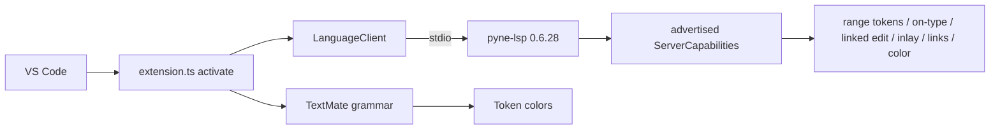

# Copyright (C) 2024-2026 jango_blockchained
#
# This file is part of pynescript.
#
# pynescript is free software: you can redistribute it and/or modify
# it under the terms of the GNU Affero General Public License as published by
# the Free Software Foundation, either version 3 of the License, or
# (at your option) any later version.
#
# pynescript is distributed in the hope that it will be useful,
# but WITHOUT ANY WARRANTY; without even the implied warranty of
# MERCHANTABILITY or FITNESS FOR A PARTICULAR PURPOSE.  See the
# GNU Affero General Public License for more details.
#
# You should have received a copy of the GNU Affero General Public License
# along with pynescript.  If not, see <https://www.gnu.org/licenses/>.
#
# SPDX-License-Identifier: AGPL-3.0-or-later

---
title: "VS Code Extension"
description: "PYNE VS Code extension: LanguageClient host for pyne-lsp, TextMate grammar, snippets, settings, and VSIX 0.5.3."
---

# VS Code Extension

## Abstract

**PYNE** (`hoox-sh.pyne` **0.5.3**) is a **LanguageClient host** plus a rich TextMate grammar, branded as part of the **HOOX open trading stack**. It does **not** reimplement language intelligence in TypeScript — `vscode-languageclient` speaks STDIO to `pyne-lsp` (then alias `pynescript-lsp`, then `python -m pynescript.langserver`) and forwards whatever that process advertises in `initialize`. The VSIX stays **0.5.3**; the hosted Python server is **`hoox-pyne` 0.6.28** (`src/pynescript/__about__.py`). The extension maps **`.pyne` (first-class)** plus `*.pine` / `*.pinev5` / `*.pinev6` / `*.pinescript` to language id `pinescript`, ships **snippets**, and exposes a broad `pynescript.*` settings surface with per-feature toggles.

## Conceptual model



## Interface surface

### Package identity

From `vscode-extension/package.json`:

| Field | Value |
| --- | --- |
| name | `pyne` |
| displayName | `PYNE Language Support` |
| version | `0.5.3` |
| publisher | `hoox-sh` |
| extension id | `hoox-sh.pyne` |
| icon | `media/icon.png` (HOOX mark) |
| engines.vscode | `^1.91.0` |
| main | `./out/extension.js` (esbuild bundle) |
| dependency | `vscode-languageclient` ^10 |
| galleryBanner | `#050505` dark |

### Language contribution

- **id:** `pinescript`
- **aliases:** `PYNE`, `pyne`, `pinescript`, `Pine`
- **extensions:** **`.pyne`** (first), `.pine`, `.pinev5`, `.pinev6`, `.pinescript`
- **configuration:** `language-configuration.json`
- **grammar:** `syntaxes/pinescript.tmLanguage.json` (`scopeName: source.pinescript`) — namespaces, annotations, hex colors, UDT/enum, multiline strings, plot/strategy builtins
- **snippets:** `snippets/pine.code-snippets` — `indicator`, `strategy`, `library`, `type`, `enum`, `input.*`, `plot`, `plotshape`, `ta.*`, `strategy.entry`/`close`, `if`/`for`/`switch`, `request.security`, `label.new`, `array.new<>`, multiline string

### Hosted `pyne-lsp` methods (not reimplemented in TypeScript)

The LanguageClient negotiates capabilities from `src/pynescript/langserver/config.py` (`get_server_capabilities`). The hosted server now advertises the following; the 0.5.3 extension is still only a host, but adds client-side **feature gates** so each capability can be toggled without restarting the server.

| LSP method | What the editor gets | Feature page |
| --- | --- | --- |
| `textDocument/semanticTokens/full` + `/range` | Same legend, range clipped to the viewport | [Semantic tokens](/pyne/docs/lsp/features/semantic-tokens) |
| `textDocument/onTypeFormatting` | Format the just-completed line; trigger `"\n"` | [Formatting](/pyne/docs/lsp/features/formatting) |
| `textDocument/linkedEditingRange` | Same-document live ranges for a user ident (keywords / builtin namespaces refused) | [Linked editing](/pyne/docs/lsp/features/linked-editing) |
| `textDocument/inlayHint` + `inlayHint/resolve` | Assignment type labels; parameter-name hints on dotted builtin calls (`ta.sma(close, 14)` → `source:` / `length:`). Resolve fills type `textEdits` only | [Inlay hints](/pyne/docs/lsp/features/inlay-hints) |
| `textDocument/documentLink` + `documentLink/resolve` | `http://` / `https://` URLs in comments (`//`, `/* */`, hash `# …`) and string literals. Resolve fills `tooltip` with the URL when tooltip is unset | [Document links](/pyne/docs/lsp/features/document-link) |
| `textDocument/documentColor` + `colorPresentation` | `#hex` (and named `color.*` / literal `color.rgb` / `color.new` / `color()` / `color.from_gradient`) swatches; presentation rewrites as `#rrggbb` / `#rrggbbaa` | [Document color](/pyne/docs/lsp/features/document-color) |

Also advertised (unchanged host path): diagnostics, completion + resolve, hover, signature help, definition / references, highlight + rename, document / workspace symbols, full + range formatting, folding, selection range, Convert-to-v6 / W001 / W002 / C002 code actions. Capability table: [Architecture](/pyne/docs/lsp/architecture).

`[pinescript]` configuration defaults already set `editor.semanticHighlighting.enabled` to `true` and `editor.defaultFormatter` to `hoox-sh.pyne`. Format-on-type and linked-editing UX are standard VS Code editor settings (`editor.formatOnType`, `editor.linkedEditing`) — they are **not** `pynescript.*` keys. Enable them if you want Enter to hit `onTypeFormatting` or rename-as-you-type to hit `linkedEditingRange`.

### Activation

```text
onLanguage:pinescript
onCommand:pynescript.restartServer
onCommand:pynescript.formatDocument
onCommand:pynescript.showLspOutput
onCommand:pynescript.showLspCommand
onCommand:pynescript.convertToV6
onCommand:pynescript.diagnosticsToggle
onCommand:pynescript.completionToggle
onCommand:pynescript.inlayHintsToggle
onCommand:pynescript.foldingToggle
onCommand:pynescript.colorPreviewToggle
onCommand:pynescript.toggleHover
onCommand:pynescript.toggleSignatureHelp
onCommand:pynescript.toggleSemanticTokens
onCommand:pynescript.toggleDocumentHighlight
onCommand:pynescript.toggleLinkedEditing
onCommand:pynescript.toggleSelectionRange
onCommand:pynescript.toggleDocumentLink
onCommand:pynescript.toggleCodeAction
onCommand:pynescript.toggleFormatOnSave
onCommand:pynescript.openDocumentLink
onCommand:pynescript.runOnPro
onCommand:pynescript.installLanguageServer
onCommand:pynescript.installBackend
onCommand:pynescript.startBackend
onCommand:pynescript.testBackend
onCommand:pynescript.selectTheme
onCommand:pynescript.selectSyntax
workspaceContains:**/*.pyne
workspaceContains:**/*.pine
workspaceContains:**/*.pinev5
workspaceContains:**/*.pinev6
```

### Settings (`pynescript.*`)

| Key | Default | Meaning |
| --- | --- | --- |
| `lsp.enabled` | `true` | Do not start the language client when false (commands still register) |
| `lsp.command` | `auto` | `auto` = PATH `pyne-lsp` → `pynescript-lsp` → `python -m pynescript.langserver`. Or an absolute path. `"docker"` plus `lsp.args` can launch `ghcr.io/hoox-sh/pyne/lsp:0.6.28` (`${workspaceFolder}` is expanded). |
| `lsp.python` | `python3` | Interpreter for module launch when neither binary is on PATH (`pip install "hoox-pyne[lsp]"`) |
| `lsp.args` | `[]` | Extra server args |
| `formatting.enabled` | `true` | Enable formatting support |
| `diagnostics.enabled` | `true` | Diagnostic squiggles |
| `diagnostics.severity` | `{}` | Override severity by lint code prefix, e.g. `{"W": "Hint"}` |
| `completion.snippets` | `true` | Snippet inserts for builtins |
| `formatOnSave.enabled` | `false` | Format the document on save (requires `formatting.enabled`) |
| `hover.enabled` | `true` | Hover information |
| `signatureHelp.enabled` | `true` | Signature help on call arguments |
| `semanticTokens.enabled` | `true` | Token colorization by language type |
| `documentHighlight.enabled` | `true` | Highlight identifier occurrences |
| `linkedEditing.enabled` | `true` | Rename-as-you-type for the same identifier |
| `selectionRange.enabled` | `true` | Smart selection around the cursor |
| `documentLink.enabled` | `true` | Clickable `http(s)` links in comments/strings |
| `codeAction.enabled` | `true` | Code actions (Convert to v6, W001 QuickFix) |
| `pro.enabled` | `false` | Enable PYNE Pro integration (`Run on Pro`) |
| `pro.apiKey` | `""` | Pro API key (password-masked in settings UI) |
| `backend.url` | `http://127.0.0.1:5002` | Backend base URL (local or self-hosted) |
| `backend.useHosted` | `false` | Use `pynescript.online` (hosted PYNE Pro) instead of `backend.url` |
| `backend.hostedUrl` | `https://pynescript.online` | Hosted backend URL |
| `backend.package` | `hoox-pyne[pro,lsp]` | pip spec for the backend install |
| `backend.path` | `""` | PYNE checkout for `Start Backend` (empty = workspace folder) |
| `install.autoInstall` | `false` | Install `hoox-pyne[lsp]` automatically when missing (no prompt) |
| `install.autoPrompt` | `true` | Offer to install the server when missing |
| `install.package` | `hoox-pyne[lsp]` | pip requirement spec to install |
| `install.python` | `""` | Python used for pip (empty = `lsp.python` → `python3` → `python` → `py`) |
| `install.args` | `[]` | Extra pip args (e.g. `["--no-cache-dir"]`) |
| `install.createVenv` | `true` | Auto-create an isolated venv for PEP 668 Python |
| `install.venv` | `""` | Explicit venv directory (empty = extension storage) |
| `theme` | `none` | Workbench theme: `none` (user/system) / `void` / `volt` / `orange` |
| `syntaxHighlighting` | `void` | Pine syntax palette: `none` (active theme) / `void` / `volt` / `orange` |

Feature gates are enforced **client-side** by middleware that reads the setting live, so toggling a `pynescript.*.enabled` key takes effect immediately — no server restart. Diagnostics, completion snippets, and formatting are passed as initialization options too.

Initialization options object:

```json
{
  "formattingEnabled": true,
  "snippetsEnabled": true,
  "diagnosticsEnabled": true
}
```

Docker stdio example (`lsp.command` = `docker`):

```json
{
  "pynescript.lsp.command": "docker",
  "pynescript.lsp.args": [
    "run", "--rm", "-i",
    "-v", "${workspaceFolder}:/work", "-w", "/work",
    "ghcr.io/hoox-sh/pyne/lsp:0.6.28"
  ]
}
```

That image is the Python language server (**0.6.28**), not the VSIX.

### Commands

| Command palette | ID | Action |
| --- | --- | --- |
| **PYNE: Restart Language Server** | `pynescript.restartServer` | Stop then start the language client |
| **PYNE: Format Document** | `pynescript.formatDocument` | `editor.action.formatDocument` (`.pyne` / `.pine`) |
| **PYNE: Convert to Pine v6** | `pynescript.convertToV6` | Rewrite v1-v5 source toward v6 (LSP command or local Python) |
| **PYNE: Show Language Server Output** | `pynescript.showLspOutput` | Open Output channel / status-bar target |
| **PYNE: Show Resolved LSP Launch Command** | `pynescript.showLspCommand` | Show and copy resolved `pyne-lsp` launch |
| **PYNE: Toggle Diagnostics** | `pynescript.diagnosticsToggle` | Flip `pynescript.diagnostics.enabled` |
| **PYNE: Toggle Completion** | `pynescript.completionToggle` | Flip `pynescript.completion.snippets` |
| **PYNE: Toggle Inlay Hints** | `pynescript.inlayHintsToggle` | Flip `[pinescript].editor.inlayHints.enabled` |
| **PYNE: Toggle Folding** | `pynescript.foldingToggle` | Flip `[pinescript].editor.folding` |
| **PYNE: Toggle Color Preview** | `pynescript.colorPreviewToggle` | Flip `[pinescript].editor.colorDecorators` |
| **PYNE: Toggle Hover** | `pynescript.toggleHover` | Flip `pynescript.hover.enabled` |
| **PYNE: Toggle Signature Help** | `pynescript.toggleSignatureHelp` | Flip `pynescript.signatureHelp.enabled` |
| **PYNE: Toggle Semantic Tokens** | `pynescript.toggleSemanticTokens` | Flip `pynescript.semanticTokens.enabled` (+ `[pinescript].editor.semanticHighlighting.enabled`) |
| **PYNE: Toggle Document Highlight** | `pynescript.toggleDocumentHighlight` | Flip `pynescript.documentHighlight.enabled` |
| **PYNE: Toggle Linked Editing** | `pynescript.toggleLinkedEditing` | Flip `pynescript.linkedEditing.enabled` |
| **PYNE: Toggle Selection Range** | `pynescript.toggleSelectionRange` | Flip `pynescript.selectionRange.enabled` |
| **PYNE: Toggle Document Links** | `pynescript.toggleDocumentLink` | Flip `pynescript.documentLink.enabled` |
| **PYNE: Toggle Code Actions** | `pynescript.toggleCodeAction` | Flip `pynescript.codeAction.enabled` |
| **PYNE: Toggle Format on Save** | `pynescript.toggleFormatOnSave` | Flip `pynescript.formatOnSave.enabled` |
| **PYNE: Open Document Link** | `pynescript.openDocumentLink` | Open the `http(s)` link under the cursor |
| **PYNE: Run on Pro** | `pynescript.runOnPro` | POST active script to the backend `/run` (local or hosted) |
| **PYNE: Install Language Server** | `pynescript.installLanguageServer` | `pip install --upgrade "hoox-pyne[lsp]"` into the resolved Python |
| **PYNE: Install Backend (Pro API)** | `pynescript.installBackend` | Install `hoox-pyne[pro,lsp]` (full backend extras) |
| **PYNE: Start Backend** | `pynescript.startBackend` | Run `python -m backend.app` from a checkout |
| **PYNE: Test Backend Connection** | `pynescript.testBackend` | GET `{backend}/health` |
| **PYNE: Select Workbench Theme (None / Void / Volt / Orange)** | `pynescript.selectTheme` | Workbench UI + hover cards |
| **PYNE: Select Syntax Highlighting (None / Void / Volt / Orange)** | `pynescript.selectSyntax` | Pine token colors |

### Client options

- Document selector: `pinescript` for `file` and `untitled` schemes
- File watcher: `**/*.{pyne,pine,pinev5,pinev6,pinescript}`
- Diagnostic collection name: `pynescript`
- Default formatter id: `hoox-sh.pyne`

## Internals

| Path | Role |
| --- | --- |
| `vscode-extension/src/extension.ts` | Activate / deactivate / client / middleware gates |
| `vscode-extension/package.json` | Contributes + scripts |
| `vscode-extension/syntaxes/pinescript.tmLanguage.json` | Grammar |
| `vscode-extension/snippets/pine.code-snippets` | Snippets |
| `vscode-extension/language-configuration.json` | Brackets / comments |
| `vscode-extension/src/test/` | `@vscode/test-electron` tests |
| `out/extension.js` | Compiled JS |

Server launch (`resolveLspLaunch` in `extension.ts`):

1. If `pynescript.lsp.command` is not `auto`, spawn that command with `lsp.args`.
2. Else try `pyne-lsp`, then `pynescript-lsp`, on `PATH`.
3. Else try `pynescript.lsp.python`, then `pynescript.install.python`, then `python3` / `python` / `py` with `-m pynescript.langserver`.
4. Else status-bar error and the install offer (below).

No `--parent-dir` / `PYTHONPATH` rewrite. Transport is STDIO. Release packaging expects `pyne-lsp` on `PATH` (pip, Nuitka onefile, or `docker run --rm -i ghcr.io/hoox-sh/pyne/lsp:0.6.28`). The **VSIX stays 0.5.3**; the GHCR tag tracks the Python package (`__about__.py` **0.6.28**), not the extension version.

### Automatic install

When `resolveLspLaunch` finds nothing and `lsp.command` is `auto`, the extension can install the server itself:

- `install.autoInstall = true` → install immediately (no prompt).
- `install.autoPrompt = true` (default) → one-time modal prompt: **Install now** / **Later** / **Don't ask again** (sets `autoPrompt=false`).
- **PYNE: Install Language Server** → run it manually at any time.

The flow resolves an interpreter (`install.python` → `lsp.python` → `python3` → `python` → `py`), requires Python ≥ 3.10 and pip, then runs:

```bash
<python> -m pip install --upgrade --disable-pip-version-check <install.args…> "hoox-pyne[lsp]"
```

pip output streams to the **PYNE Language Server** output channel under a cancellable progress notification. On success the client restarts; on failure the last lines are logged.

When the resolved Python is **externally managed** (PEP 668 — common on Debian/Ubuntu), `install.createVenv` (default `true`) makes the extension create an isolated virtualenv under its global storage (`install.venv` overrides the path), install there, and record the venv interpreter in `install.python` so module launch uses it. Set `install.createVenv = false` to install into the system Python instead. Installs are deduplicated, so the prompt and palette command cannot run concurrently.

### Build

```bash
cd vscode-extension
npm ci
npm run compile          # esbuild.mjs → out/extension.js
npm run package          # pyne-vscode-0.5.3.vsix
# or monorepo:
make build-vscode
```

Requires Node 22. `compile:tsc` is typecheck-only (`tsc --noEmit`). `npm test` compiles tests with `tsc` and runs them via `@vscode/test-electron` (needs a VS Code download and a display / xvfb).

Site download: [https://hoox.sh/pyne-vscode.vsix](https://hoox.sh/pyne-vscode.vsix) (unversioned alias). Versioned `pyne-vscode-0.5.3.vsix` is built in-tree (`vscode-extension/`) and on GitHub Releases.

### Snippets

`contributes.snippets` ships `snippets/pine.code-snippets` for language id `pinescript`. Type a prefix and press `Tab`:

| Prefix | Expands to |
| --- | --- |
| `indicator` / `strategy` / `library` | v6 script declaration |
| `type` / `enum` | UDT / enum skeleton |
| `input.int` / `input.float` / `input.string` / `input.bool` / `input.source` | typed inputs |
| `plot` / `plotshape` | plot helpers |
| `ta.sma` / `ta.ema` / `ta.rsi` / `ta.atr` / `ta.stdev` / `ta.crossover` / `ta.crossunder` | indicator calls |
| `strategy.entry` / `strategy.close` | order helpers |
| `pineif` / `pinefor` / `pineswitch` | control flow |
| `request.security` | multi-timeframe request |
| `label.new` / `array.new` / `triplequote` | drawings, arrays, multiline strings |

### Backend and Pro (`Run on Pro`)

The extension talks to a PYNE backend for `Run on Pro`. Two modes:

**Local / self-hosted** — point at `backend.url` (default `http://127.0.0.1:5002`):

```json
{
  "pynescript.pro.enabled": true,
  "pynescript.backend.url": "http://127.0.0.1:5002"
}
```

**Hosted PYNE Pro** — flip the hosted toggle; the effective URL becomes `backend.hostedUrl` (default `https://pynescript.online`) and an API key is required:

```json
{
  "pynescript.pro.enabled": true,
  "pynescript.pro.apiKey": "pyn_…",
  "pynescript.backend.useHosted": true
}
```

`pro.apiKey` is password-masked. **PYNE: Run on Pro** sends `{ script, data, symbol, mode }` to `{backend}/run`; the `Authorization: Bearer <key>` header is added only when a key is set (hosted always requires it). `backend.url`/`backend.hostedUrl` are base URLs only (no trailing `/run`).

**Install / start / test:**

- **PYNE: Install Backend (Pro API)** installs `backend.package` (default `hoox-pyne[pro,lsp]`) with the same pip/venv flow as the language server.
- **PYNE: Start Backend** runs `python -m backend.app` from `backend.path` (or the workspace folder) in a terminal, with `PORT` taken from the backend URL. Requires a PYNE checkout containing `backend/app.py`.
- **PYNE: Test Backend Connection** GETs `{backend}/health`.

### Themes (Void / Volt / Orange)

Two independent options:

| Option | Setting | Values | `none` means |
| --- | --- | --- | --- |
| **Workbench theme** | `pynescript.theme` | `none` · `void` · `volt` · `orange` | Keep the user/system theme |
| **Syntax highlighting** | `pynescript.syntaxHighlighting` | `none` · `void` · `volt` · `orange` | Use the active theme's Pine colors |

The workbench theme sets the UI chrome and hover cards (`editorHoverWidget.*`, `editorSuggestWidget.*`). The syntax option sets only the Pine TextMate + semantic token colors (keywords and functions → accent, strings → accent tint, numbers → foreground, comments/punctuation/series builtins → neutral gray), so you can keep your own editor theme and still get AXIS Pine highlighting.

| Theme | Accent | Notes |
| --- | --- | --- |
| **PYNE Void** | indigo `#939FFF` | Near-black surfaces |
| **PYNE Volt** | lime `#B7EF09` | Neutral surfaces with a whisper of lime |
| **PYNE Orange** | signal orange `#FE6A00` | Warm signal accent |

Switch with **PYNE: Select Workbench Theme** / **PYNE: Select Syntax Highlighting**, or set the keys directly. Defaults: workbench `none`, syntax `void`.

## Invariants and edge cases

1. **`lsp.enabled === false` skips starting the client** — output channel, status bar, and palette commands still register so the palette never shows “command not found”; restart then no-ops until the setting is true.
2. **Binary vs module:** production users should install `hoox-pyne[lsp]` or the Nuitka onefile (`pynescript-lsp-*` on GitHub Releases) and set `pynescript.lsp.command` if not on PATH.
3. **Grammar works without LSP** — open a `.pyne` or `.pine` file offline and still get TextMate highlighting.
4. **`.pyne` is first-class** in `package.json` extensions + activation; legacy `.pine*` / `.pinescript` remain fully supported.
5. File watcher covers every associated suffix (`pyne`, `pine`, `pinev5`, `pinev6`, `pinescript`).
6. **VSIX 0.5.3 does not pin server methods.** Range tokens, on-type format, linked editing, inlay resolve / param names, document links + resolve tooltip, and document color appear only when the spawned `pyne-lsp` is new enough to advertise them (this tree: **0.6.28**). Feature gates are client-side and read live settings.

## Worked example — extension development

```bash
pip install -e ".[lsp]"
cd vscode-extension && npm ci && npm run compile
# Launch Extension Development Host pointing at vscode-extension
```

Open a fixture `.pine` file; confirm Problems panel shows parse/lint diagnostics from the Python server. With a current `pyne-lsp`, also expect `#hex` color swatches, clickable `https://` links in comments, `source:` / `length:` inlay labels on `ta.sma(close, 14)`, and range semantic tokens while scrolling.

## Failure modes

| Symptom | Cause |
| --- | --- |
| “Language client failed to start” | `pyne-lsp` missing / wrong command |
| No squiggles, highlighting OK | LSP disabled or server crash; check Output → PYNE Language Server |
| Restart does nothing | Client never started (`lsp.enabled` false) |
| No inlay param names / color swatches / document links | Spawned `pyne-lsp` is older than this tree (need **0.6.28**) |
| Enter does not reformat the previous line | `editor.formatOnType` is off (not a `pynescript.*` key) |
| Identifiers do not multi-cursor as you type | `editor.linkedEditing` is off (not a `pynescript.*` key) |
| A feature does nothing after toggling | Its `pynescript.<feature>.enabled` key is `false` |
| **Run on Pro** says “disabled” | Set `pynescript.pro.enabled` (and `pro.apiKey` for hosted) |
| **Run on Pro** request fails | Check `pynescript.backend.url` / `backend.useHosted` (base URL, no `/run`) and that the backend is reachable |

## See also

- [Architecture](/pyne/docs/lsp/architecture) — declared `ServerCapabilities`
- [Semantic tokens](/pyne/docs/lsp/features/semantic-tokens) — full and range
- [Formatting](/pyne/docs/lsp/features/formatting) — full, range, and on-type (`\n`)
- [Linked editing](/pyne/docs/lsp/features/linked-editing)
- [Inlay hints](/pyne/docs/lsp/features/inlay-hints) — types, param names, resolve
- [Document links](/pyne/docs/lsp/features/document-link) — `http(s)` URLs; resolve fills tooltip
- [Document color](/pyne/docs/lsp/features/document-color)
- [Clients](/pyne/docs/lsp/clients) — non-VS Code hosts
- [Nuitka build](/pyne/docs/devops/nuitka-build)
- [Editors guide](/pyne/docs/enduser/guides/editors)
